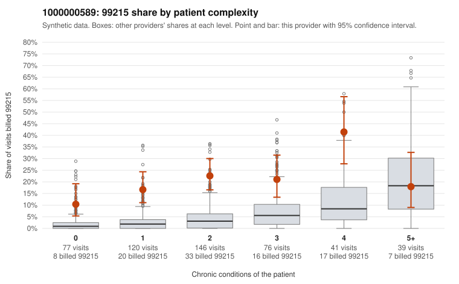

# 1000000589: Provider 1000000589 bills 99215 far above risk-adjusted expectation, with elevated rates even on 0-1 condition patients, but only four documented 99215 claims exist, all supported, so documentation is too thin to judge.

**Leaning (advisory):** Inconclusive

## Why

1000000589 billed 99215 on 20.2% of 499 claims against an expected 3.9% given patient complexity (risk-adjusted score 7.38; plain z-score vs peers 2.93). 28% of this provider's 99215 claims were on patients with 0 or 1 chronic conditions. Records came back for 19 claims. Of 4 documented 99215 claims, 0 (0%) were documented below the billed level, against 9% for the comparison providers. Note checks on 19 returned notes (share showing each sign): problems 16%, late 5%, unsigned 0%, data 10%. No audit trail was received. 5 of 15 notes claiming moderate-or-higher data reviewed had no lab or test line on the claim. The billing pattern leans toward concern: the 99215 share runs several times the all-provider rate in every complexity band except 5+, and sampled low-complexity 99215 claims carry single routine diagnoses such as rash (C0312390), UTI (C0312408), follow-up exam (C0312575, C0312802) and upper respiratory infection (C0312641), which a heavier panel would not explain. Against that, the few returned charts all support the billed level, including low-complexity C0312901, so there is no direct documentation evidence of upcoding. With records on only a small share of claims and just four documented 99215s, the support rate cannot be trusted either way. The note signals add only weak caution: notes claim moderate-or-higher data review on claims with no lab or test line, and repeated time entries and duplicate notes appear, which may point to templated or cloned documentation, but no audit trail was received to test this. A reviewer should first request charts for the sampled low-complexity 99215 claims (for example C0312390, C0312408, C0312575, C0312641, C0312802) and the EHR audit trail, then check whether notes like C0312901 and C0312548 reflect the actual visit or copied content. Examples: C0312390: billed 99215, patient aged 41 with 0 chronic condition(s). C0312405: billed 99215, patient aged 51 with 1 chronic condition(s) (hyperlipidemia).

## Evidence chart

## Cited claims

`C0312390`, `C0312405`

## Suggested next steps

- 19 charts came back but do not settle it: request a targeted sample of 99215 charts, starting with C0312390, C0312405.
- Re-check after the targeted charts arrive; do not call upcoding or a sicker panel on this evidence alone.

---
Citations checked: 2/2 valid. Synthetic data. The leaning is advisory; the flag comes from the statistical screen, and no clinical documentation is available beyond the sampled records-review facts shown in the packet.
