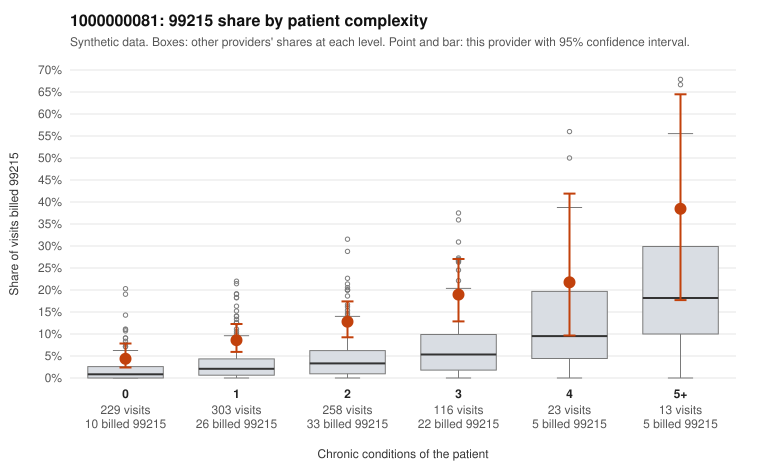

# 1000000081: Provider 1000000081 bills 99215 well above expectation in every complexity tier, including many low-complexity patients, but records are too thin to tell upcoding from a sicker panel.

**Leaning (advisory):** Inconclusive

## Why

1000000081 billed 99215 on 10.7% of 942 claims against an expected 2.8% given patient complexity (risk-adjusted score 5.77; plain z-score vs peers 1.15). 36% of this provider's 99215 claims were on patients with 0 or 1 chronic conditions. Records came back for 30 claims. Of 3 documented 99215 claims, 0 (0%) were documented below the billed level, against 7% for the comparison providers. 2 of 21 notes claiming moderate-or-higher data reviewed had no lab or test line on the claim. The elevated 99215 rate is not explained by case mix. The share runs about double the all-provider rate in every condition-count band, and a sizable portion lands on patients with zero or one chronic condition, such as the rash, abdominal pain and URI visits in C0035146, C0035251 and C0036009. Documentation is too thin to judge 99215 itself: only three charts came back, and all supported the billed level, including C0035677, a single-condition hypertension visit documented at high MDM. The 99214 charts, however, show an unsupported rate well above peers, with three notes at low MDM and no minutes recorded (C0035228, C0035501, C0035556). That matters because 99214 dominates this provider's mix. The few notes claiming moderate-or-higher data review with no lab line are only weak signals of templated documentation. A reviewer should first request charts for the sampled low-complexity 99215 claims and expand the 99214 record pull to see whether the low-MDM pattern holds. Examples: C0035228: billed 99214; documented MDM level low, minutes not recorded. C0035501: billed 99214; documented MDM level low, minutes not recorded. C0035081: billed 99215, patient aged 60 with 1 chronic condition(s) (asthma). C0035090: billed 99215, patient aged 68 with 1 chronic condition(s) (type 2 diabetes).

## Evidence chart

## Cited claims

`C0035228`, `C0035501`, `C0035081`, `C0035090`

## Suggested next steps

- Request records for a larger sample of this provider's 99214 and 99215 claims; what came back is too thin to judge.
- Re-screen the provider once the records arrive.

---
Citations checked: 4/4 valid. Synthetic data. The leaning is advisory; the flag comes from the statistical screen, and no clinical documentation is available beyond the sampled records-review facts shown in the packet.
