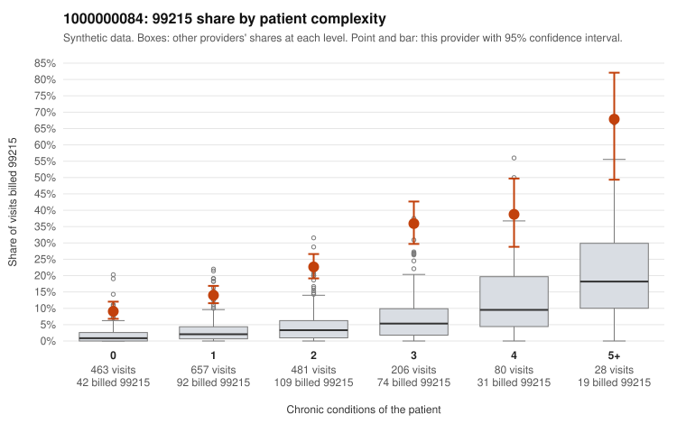

# 1000000084: Provider 1000000084 bills 99215 well above expectation in every complexity tier, including simple acute visits, but the few charts returned support the billed levels, so the evidence is mixed.

**Leaning (advisory):** Inconclusive

## Why

1000000084 billed 99215 on 19.2% of 1,915 claims against an expected 2.9% given patient complexity (risk-adjusted score 17.04; plain z-score vs peers 2.80). 37% of this provider's 99215 claims were on patients with 0 or 1 chronic conditions. Records came back for 26 claims. Of 8 documented 99215 claims, 0 (0%) were documented below the billed level, against 7% for the comparison providers. 2 of 21 notes claiming moderate-or-higher data reviewed had no lab or test line on the claim. The claims pattern is the main concern. The 99215 share runs roughly three to four times the all-provider rate in every complexity tier, including patients with no chronic conditions, and the sampled low-complexity 99215 claims carry routine acute diagnoses such as upper respiratory infection (C0037109, C0037438), rash (C0037183), back pain (C0037248) and UTI (C0037927), which rarely need high-complexity decision-making. Against this, all 8 documented 99215 claims supported the billed level, with high MDM on examples such as C0037210 and C0037503. However, charts came back for only a small share of claims, and with 8 documented 99215s even an honest provider would be expected to show zero or one mismatch, so the documentation neither clears nor implicates the provider. The 2 notes claiming moderate-or-higher data review with no lab or test line on the claim are a weak hint of templated or inflated notes, not proof. A reviewer should first request charts targeted at the 0–1 condition 99215 claims, starting with the sampled acute-diagnosis claims above, and check whether the notes show genuine high-complexity decision-making or cloned, templated content. Examples: C0038107: billed 99214; documented MDM level low, minutes not recorded. C0037071: billed 99215, patient aged 41 with 1 chronic condition(s) (atrial fibrillation). C0037109: billed 99215, patient aged 48 with 0 chronic condition(s).

## Evidence chart

## Cited claims

`C0038107`, `C0037071`, `C0037109`

## Suggested next steps

- Request records for a larger sample of this provider's 99214 and 99215 claims; what came back is too thin to judge.
- Re-screen the provider once the records arrive.

---
Citations checked: 3/3 valid. Synthetic data. The leaning is advisory; the flag comes from the statistical screen, and no clinical documentation is available beyond the sampled records-review facts shown in the packet.
