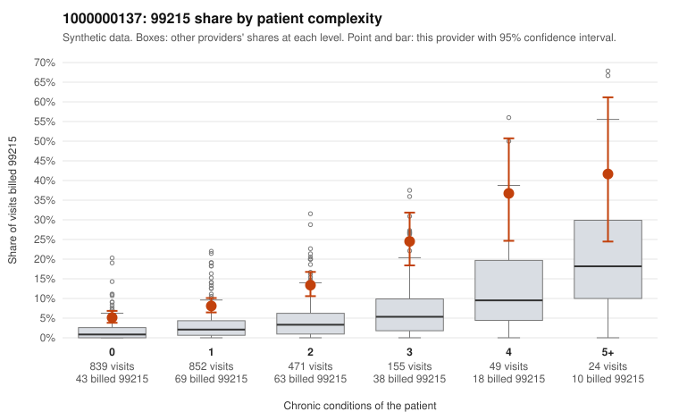

# 1000000137: Provider 1000000137 bills 99215 at roughly four times the complexity-adjusted expectation across every complexity stratum, with nearly half on low-complexity patients, but documentation is too thin to confirm or refute upcoding.

**Leaning (advisory):** Inconclusive

## Why

1000000137 billed 99215 on 10.1% of 2,390 claims against an expected 2.4% given patient complexity (risk-adjusted score 9.58; plain z-score vs peers 1.02). 46% of this provider's 99215 claims were on patients with 0 or 1 chronic conditions. Records came back for 30 claims. Of 4 documented 99215 claims, 1 (25%) were documented below the billed level, against 7% for the comparison providers. 5 of 16 notes claiming moderate-or-higher data reviewed had no lab or test line on the claim. The billing pattern leans toward upcoding. The 99215 share is elevated at every complexity level, not just among sicker patients, and the low-complexity sample includes 99215s for routine presentations such as back pain (C0067913, C0068423), rash (C0068491) and follow-up visits (C0068736, C0069103). The high-complexity sample (e.g., C0069317, C0069634) looks consistent with legitimate level-5 visits, so the panel is mixed rather than uniformly simple. The documentation cannot settle the question: only 4 documented 99215 claims exist, one of which (C0068913) was documented at moderate MDM, while C0068621, a 0-condition rash visit, was documented at high MDM. The 5 notes claiming moderate-or-higher data reviewed without a lab or test line on the claim are weak evidence that some notes may be inflated or cloned. A reviewer should first request charts for the sampled low-complexity 99215 claims, especially C0068621 and the other 0-condition rash and back-pain visits, and check whether the notes reflect the actual encounter or templated text. Examples: C0068913: billed 99215; documented MDM level moderate, 36 minutes. C0067913: billed 99215, patient aged 32 with 0 chronic condition(s). C0068252: billed 99215, patient aged 49 with 0 chronic condition(s).

## Evidence chart

## Cited claims

`C0068913`, `C0067913`, `C0068252`

## Suggested next steps

- Request records for a larger sample of this provider's 99214 and 99215 claims; what came back is too thin to judge.
- Re-screen the provider once the records arrive.

---
Citations checked: 3/3 valid. Synthetic data. The leaning is advisory; the flag comes from the statistical screen, and no clinical documentation is available beyond the sampled records-review facts shown in the packet.
