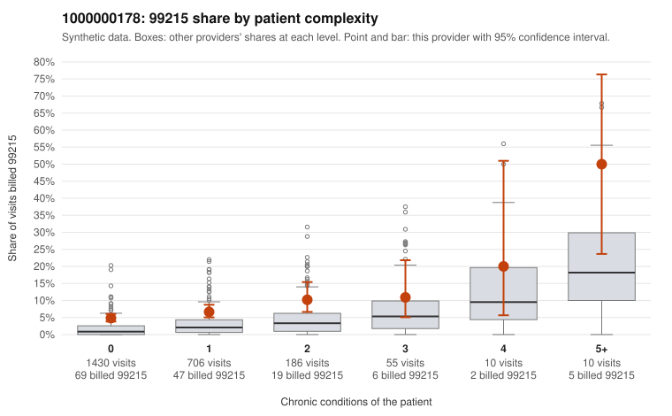

# 1000000178: 1000000178: too few returned records to judge

**Leaning (advisory):** Inconclusive

## Why

1000000178 billed 99215 on 6.2% of 2,397 claims against an expected 1.9% given patient complexity (risk-adjusted score 6.14; plain z-score vs peers 0.26). 78% of this provider's 99215 claims were on patients with 0 or 1 chronic conditions. Records came back for 0 claims. No documented 99215 claims came back. The evidence does not support a call either way yet. Examples: C0094603: billed 99215, patient aged 82 with 1 chronic condition(s) (heart failure). C0094620: billed 99215, patient aged 57 with 1 chronic condition(s) (asthma).

## Evidence chart

## Cited claims

`C0094603`, `C0094620`

## Suggested next steps

- Request records for a larger sample of this provider's 99214 and 99215 claims; what came back is too thin to judge.
- Re-screen the provider once the records arrive.

---
Citations checked: 2/2 valid. Synthetic data. The leaning is advisory; the flag comes from the statistical screen, and no clinical documentation is available beyond the sampled records-review facts shown in the packet.
