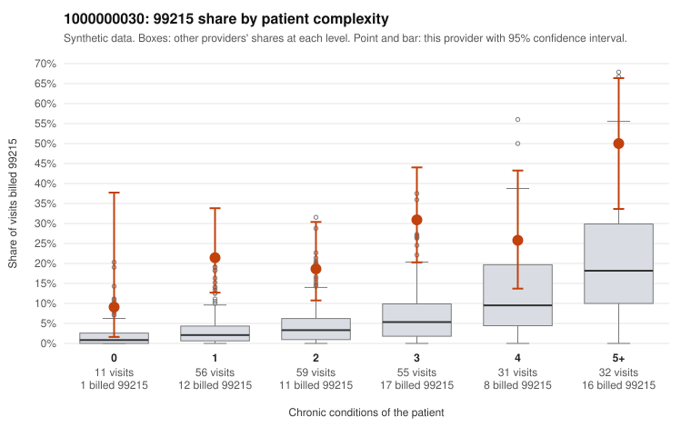

# 1000000030: Provider 1000000030's 99215 rate is far above expectation in every complexity group, but the few returned charts all support the billed level, and duplicate-text and late-note signals leave open whether those charts reflect the visits.

**Leaning (advisory):** Inconclusive

## Why

1000000030 billed 99215 on 26.6% of 244 claims against an expected 5.3% given patient complexity (risk-adjusted score 5.92; plain z-score vs peers 4.26). 20% of this provider's 99215 claims were on patients with 0 or 1 chronic conditions. Records came back for 24 claims. Of 10 documented 99215 claims, 0 (0%) were documented below the billed level, against 7% for the comparison providers. Note checks on 24 returned notes (share showing each sign): problems 21%, late 21%, unsigned 0%, data 17%. No audit trail was received. 4 of 19 notes claiming moderate-or-higher data reviewed had no lab or test line on the claim. The excess 99215 billing persists after risk adjustment and appears in every complexity stratum, including low-complexity visits such as C0012768 (no chronic conditions, URI diagnosis only) and repeated single-diagnosis depression visits for one patient (C0012607, C0012615); a sicker panel alone would not readily explain that pattern. Against this, none of the documented 99215 claims fell below the billed level (examples include C0012626 and C0012769), which points toward a legitimately complex panel rather than upcoding. That support is ambiguous for three reasons: records cover only about a tenth of claims, a third of returned notes show duplicate text, and a few claim moderate-or-higher data review with no lab or test line on the claim. Together these are weak signs of cloned or inflated notes, not proof. First, a reviewer should obtain the audit trail and compare the duplicate-flagged notes side by side. Then they should request charts specifically for the low-complexity 99215 claims, such as C0012631, which is also flagged for a late note, to test whether high MDM is genuinely documented on simple visits. Examples: C0012590: billed 99215, patient aged 18 with 1 chronic condition(s) (obesity). C0012607: billed 99215, patient aged 41 with 1 chronic condition(s) (depression).

## Evidence chart

## Cited claims

`C0012590`, `C0012607`

## Suggested next steps

- 24 charts came back but do not settle it: request a targeted sample of 99215 charts, starting with C0012590, C0012607.
- Re-check after the targeted charts arrive; do not call upcoding or a sicker panel on this evidence alone.

---
Citations checked: 2/2 valid. Synthetic data. The leaning is advisory; the flag comes from the statistical screen, and no clinical documentation is available beyond the sampled records-review facts shown in the packet.
