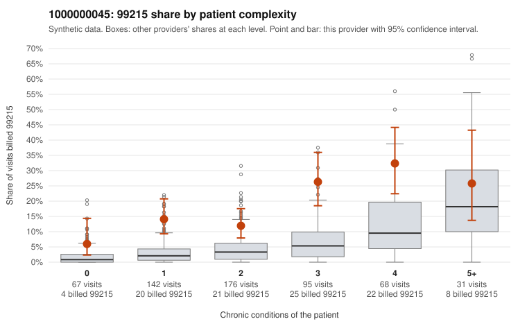

# 1000000045: 1000000045: 15 of 20 documented 99215 claims (75%) are documented below the billed level

**Leaning (advisory):** Pattern consistent with upcoding

## Why

1000000045 billed 99215 on 17.3% of 579 claims against an expected 4.1% given patient complexity (risk-adjusted score 6.35; plain z-score vs peers 2.43). 24% of this provider's 99215 claims were on patients with 0 or 1 chronic conditions. Records came back for 43 claims. Of 20 documented 99215 claims, 15 (75%) were documented below the billed level, against 7% for the comparison providers. Note checks on 43 returned notes (share showing each sign): problems 7%, late 2%, unsigned 0%, data 0%. No audit trail was received. 0 of 30 notes claiming moderate-or-higher data reviewed had no lab or test line on the claim. This pattern is consistent with upcoding. It is a reason to review the records, not a finding. Examples: C0017129: billed 99215; documented MDM level moderate, 31 minutes. C0017324: billed 99215; documented MDM level moderate, 35 minutes. C0017417: billed 99215; documented MDM level moderate, 32 minutes. C0017053: billed 99215, patient aged 54 with 1 chronic condition(s) (hypothyroidism). C0017064: billed 99215, patient aged 39 with 1 chronic condition(s) (obesity). C0017080: billed 99215, patient aged 36 with 1 chronic condition(s) (obesity).

## Evidence chart

## Cited claims

`C0017129`, `C0017324`, `C0017417`, `C0017053`, `C0017064`, `C0017080`

## Suggested next steps

- Request the full charts for C0017129, C0017324, C0017417 and have a certified coder re-score each against the current E/M rules (medical decision making or total time).
- If the re-scoring confirms the pattern, review the random sample in the recovery packet's sampling plan before any overpayment estimate; do not extrapolate from a targeted sample.
- Look at the notes themselves: 7% address fewer problems than their level implies and 2% were signed late; request the audit trail for C0017129, C0017324, C0017417.

---
Citations checked: 6/6 valid. Synthetic data. The leaning is advisory; the flag comes from the statistical screen, and no clinical documentation is available beyond the sampled records-review facts shown in the packet.
