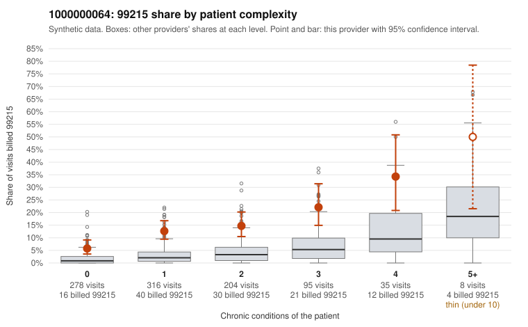

# 1000000064: Provider 1000000064 bills 99215 far above what patient complexity predicts, including on many low-complexity visits, yet the small set of returned charts largely supports the billed levels, so the pattern cannot yet be called upcoding or a sicker panel.

**Leaning (advisory):** Inconclusive

## Why

1000000064 billed 99215 on 13.1% of 936 claims against an expected 2.7% given patient complexity (risk-adjusted score 7.84; plain z-score vs peers 1.62). 46% of this provider's 99215 claims were on patients with 0 or 1 chronic conditions. Records came back for 43 claims. Of 19 documented 99215 claims, 1 (5%) were documented below the billed level, against 7% for the comparison providers. Note checks on 43 returned notes (share showing each sign): problems 28%, late 2%, unsigned 0%, data 5%. No audit trail was received. 2 of 32 notes claiming moderate-or-higher data reviewed had no lab or test line on the claim. The claims pattern points toward upcoding. The excess 99215 share appears in every complexity stratum, and nearly half of 99215s fall on patients with zero or one chronic condition, often for simple diagnoses such as upper respiratory infection (J06.9), urinary tract infection (N39.0) or rash (R21), as in C0026163, C0026057 and C0026071. Against that, the 19 documented 99215 claims show an unsupported rate below the comparison providers, which on its face fits legitimately complex visits, but records cover under 5% of claims and may not be representative. Note quality is mixed and argues for caution about taking the charts at face value. The note-check problem flag rate and repeated time entries are notable. C0026387 is a zero-condition upper respiratory visit documented as high complexity in a note that was also flagged late, and C0025776 is a low-complexity 99215 with a flagged note. These are weak signs of possible template or inflated documentation rather than proof. A reviewer should first pull the full charts and audit trail for the low-complexity 99215s, starting with C0026387, C0025776 and C0025931, and check whether the documented complexity and time are plausible for those diagnoses and whether note text repeats across visits. Examples: C0026459: billed 99215; documented MDM level moderate, minutes not recorded. C0025721: billed 99215, patient aged 37 with 1 chronic condition(s) (hyperlipidemia). C0025748: billed 99215, patient aged 48 with 0 chronic condition(s).

## Evidence chart

## Cited claims

`C0026459`, `C0025721`, `C0025748`

## Suggested next steps

- 43 charts came back but do not settle it: request a targeted sample of 99215 charts, starting with C0026459, C0025721, C0025748.
- Re-check after the targeted charts arrive; do not call upcoding or a sicker panel on this evidence alone.

---
Citations checked: 3/3 valid. Synthetic data. The leaning is advisory; the flag comes from the statistical screen, and no clinical documentation is available beyond the sampled records-review facts shown in the packet.
