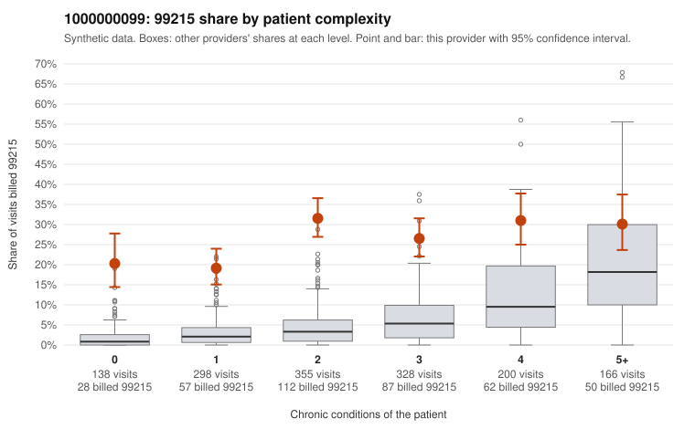

# 1000000099: Provider 1000000099's 99215 share is far above expected in every complexity stratum, including patients with no chronic conditions, but the small documented sample supports the billed levels, so the pattern is unresolved.

**Leaning (advisory):** Inconclusive

## Why

1000000099 billed 99215 on 26.7% of 1,485 claims against an expected 5.0% given patient complexity (risk-adjusted score 15.32; plain z-score vs peers 4.27). 21% of this provider's 99215 claims were on patients with 0 or 1 chronic conditions. Records came back for 45 claims. Of 20 documented 99215 claims, 0 (0%) were documented below the billed level, against 7% for the comparison providers. Note checks on 45 returned notes (share showing each sign): problems 22%, late 20%, unsigned 0%, data 18%. No audit trail was received. 8 of 39 notes claiming moderate-or-higher data reviewed had no lab or test line on the claim. The billing pattern does not look like a sicker panel. The excess 99215 use holds even for 0–1 condition patients, at roughly ten times the all-provider rate, with sampled examples such as C0047252, C0047606 and C0048364 billed at 99215 for single acute or follow-up diagnoses. Against that, every documented 99215 claim supports the billed level (for example C0047439 and C0048571). That would normally point toward legitimate complexity, but records cover only a small share of claims, so it may not represent the whole 99215 volume. The notes also carry cloning-type signals: a high duplicate rate, repeated times, late entries, and some notes claiming moderate-or-higher data review with no lab or test on the claim. This means the supported documentation may itself be templated or inflated rather than reflecting the visits. The 99214 mismatches (C0047208, C0048357) run above the comparison rate but rest on very few claims. A reviewer should first request the audit trail and a larger, targeted chart pull of low-complexity 99215 claims, then check whether the high-MDM notes are near-duplicates across patients and whether the documented data review matches orders and results. Examples: C0047208: billed 99214; documented MDM level low, minutes not recorded. C0048357: billed 99214; documented MDM level low, minutes not recorded. C0047203: billed 99215, patient aged 61 with 1 chronic condition(s) (type 2 diabetes). C0047252: billed 99215, patient aged 55 with 0 chronic condition(s).

## Evidence chart

## Cited claims

`C0047208`, `C0048357`, `C0047203`, `C0047252`

## Suggested next steps

- 45 charts came back but do not settle it: request a targeted sample of 99215 charts, starting with C0047208, C0048357, C0047203.
- Re-check after the targeted charts arrive; do not call upcoding or a sicker panel on this evidence alone.

---
Citations checked: 4/4 valid. Synthetic data. The leaning is advisory; the flag comes from the statistical screen, and no clinical documentation is available beyond the sampled records-review facts shown in the packet.
