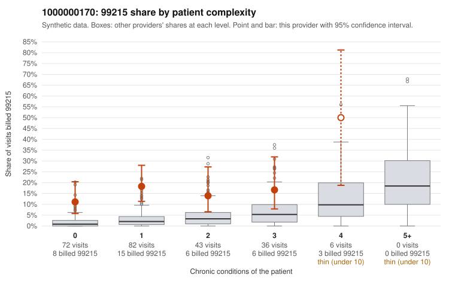

# 1000000170: Provider 1000000170's 99215 billing is concentrated on low-complexity patients, yet every documented 99215 is supported, and several note signals raise questions about whether the documentation reflects the actual visits.

**Leaning (advisory):** Inconclusive

## Why

1000000170 billed 99215 on 15.9% of 239 claims against an expected 2.6% given patient complexity (risk-adjusted score 5.08; plain z-score vs peers 2.16). 61% of this provider's 99215 claims were on patients with 0 or 1 chronic conditions. Records came back for 45 claims. Of 19 documented 99215 claims, 0 (0%) were documented below the billed level, against 7% for the comparison providers. Note checks on 45 returned notes (share showing each sign): problems 29%, late 18%, unsigned 0%, data 13%. No audit trail was received. 7 of 33 notes claiming moderate-or-higher data reviewed had no lab or test line on the claim. The billing pattern alone is concerning: the excess 99215 share sits mostly on patients with zero or one chronic condition, which is not what a sicker panel would produce. The records review points the other way, with no documented 99215 falling below the billed level. Yet sampled supported claims such as C0091915 (rash, no chronic conditions), C0091842 (abdominal pain, minutes not recorded) and C0091909 (osteoarthritis plus abdominal pain) carry high-complexity medical decision making on simple presentations, which is hard to reconcile with the diagnoses. The note-check rates for duplicate content, problem-list issues and repeated visit times, plus the stated notes claiming moderate-or-higher data review with no lab or test on the claim, are weak signals consistent with cloned or inflated documentation, not proof of it. A reviewer should first read the full notes for the low-complexity 99215 claims side by side (starting with C0091915, C0091842, C0091717 and C0091743) and compare them for templated text. They should also request the missing EHR audit trail to see whether the documentation was created contemporaneously. Examples: C0091671: billed 99215, patient aged 54 with 1 chronic condition(s) (hypertension). C0091678: billed 99215, patient aged 42 with 1 chronic condition(s) (hyperlipidemia).

## Evidence chart

## Cited claims

`C0091671`, `C0091678`

## Suggested next steps

- 45 charts came back but do not settle it: request a targeted sample of 99215 charts, starting with C0091671, C0091678.
- Re-check after the targeted charts arrive; do not call upcoding or a sicker panel on this evidence alone.

---
Citations checked: 2/2 valid. Synthetic data. The leaning is advisory; the flag comes from the statistical screen, and no clinical documentation is available beyond the sampled records-review facts shown in the packet.
