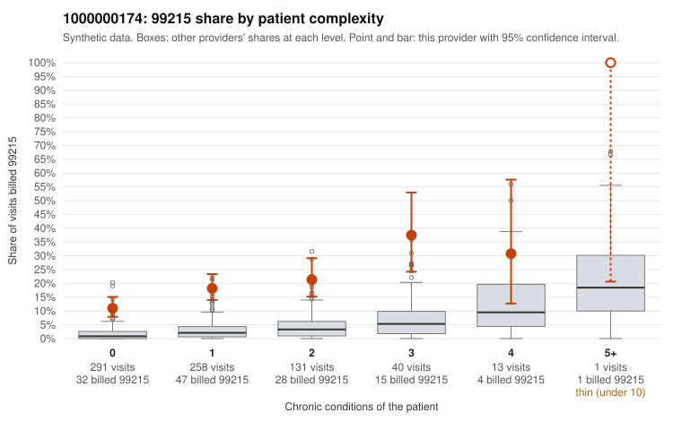

# 1000000174: Provider 1000000174's 99215 share is far above expectation and concentrated on low-complexity patients, but the few returned charts support the billed level, so the evidence is mixed.

**Leaning (advisory):** Inconclusive

## Why

1000000174 billed 99215 on 17.3% of 734 claims against an expected 2.2% given patient complexity (risk-adjusted score 10.93; plain z-score vs peers 2.43). 62% of this provider's 99215 claims were on patients with 0 or 1 chronic conditions. Records came back for 14 claims. Of 6 documented 99215 claims, 0 (0%) were documented below the billed level, against 7% for the comparison providers. Note checks on 14 returned notes (share showing each sign): problems 50%, late 0%, unsigned 0%, data 7%, bulk created 0%, paste heavy 0%. 2 of 9 notes claiming moderate-or-higher data reviewed had no lab or test line on the claim. The billing pattern is consistent with upcoding. The excess 99215 use appears in every complexity tier, including patients with no chronic conditions, and the sampled low-complexity 99215 claims carry simple diagnoses such as UTI (N39.0), URI (J06.9), rash (R21) and follow-up visits (Z09), for example C0093068, C0093100 and C0093220. Against this, all six documented 99215 claims were supported, but records came back for only about 2% of claims, which is too thin to clear the pattern. The notes also raise questions: C0093296 is a zero-condition Z09 follow-up documented as high MDM and also flagged on the problems note check, half the notes show the problems signal, visit times repeat often, and two notes claim moderate-or-higher data reviewed with no lab or test line on the claim. These are weak signs that documentation may be templated or inflated to match the billed level, not proof. A reviewer should first request a larger, randomly drawn set of charts weighted toward the 0–1 condition 99215 claims, then check whether the MDM narratives in those notes reflect the actual problem addressed and whether times and data elements are copied across visits. Examples: C0093068: billed 99215, patient aged 18 with 0 chronic condition(s). C0093100: billed 99215, patient aged 59 with 0 chronic condition(s).

## Evidence chart

## Cited claims

`C0093068`, `C0093100`

## Suggested next steps

- 14 charts came back but do not settle it: request a targeted sample of 99215 charts, starting with C0093068, C0093100.
- Re-check after the targeted charts arrive; do not call upcoding or a sicker panel on this evidence alone.

---
Citations checked: 2/2 valid. Synthetic data. The leaning is advisory; the flag comes from the statistical screen, and no clinical documentation is available beyond the sampled records-review facts shown in the packet.
