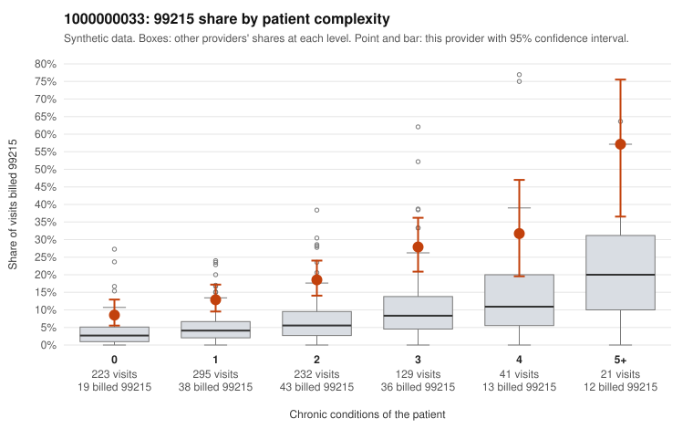

# 1000000033: 1000000033: too few returned records to judge

**Leaning (advisory):** Inconclusive

## Why

1000000033 billed 99215 on 17.1% of 941 claims against an expected 4.8% given patient complexity (risk-adjusted score 6.11; plain z-score vs peers 1.97). 35% of this provider's 99215 claims were on patients with 0 or 1 chronic conditions. Records came back for 45 claims. Of 23 documented 99215 claims, 5 (22%) were documented below the billed level, against 33% for the comparison providers. Note checks on 45 returned notes (share showing each sign): problems 29%, late 4%, unsigned 0%, data 4%. No audit trail was received. 2 of 36 notes claiming moderate-or-higher data reviewed had no lab or test line on the claim. The evidence does not support a call either way yet. Examples: C0016656: billed 99215; documented MDM level low, minutes not recorded. C0017013: billed 99215; documented MDM level moderate, 27 minutes. C0016629: billed 99215, patient aged 59 with 1 chronic condition(s) (hypothyroidism). C0016655: billed 99215, patient aged 45 with 0 chronic condition(s).

## Evidence chart

## Cited claims

`C0016656`, `C0017013`, `C0016629`, `C0016655`

## Suggested next steps

- 45 charts came back but do not settle it: request a targeted sample of 99215 charts, starting with C0016656, C0017013, C0016629.
- Re-check after the targeted charts arrive; do not call upcoding or a sicker panel on this evidence alone.

---
Citations checked: 4/4 valid. Synthetic data. The leaning is advisory; the flag comes from the statistical screen, and no clinical documentation is available beyond the sampled records-review facts shown in the packet.
