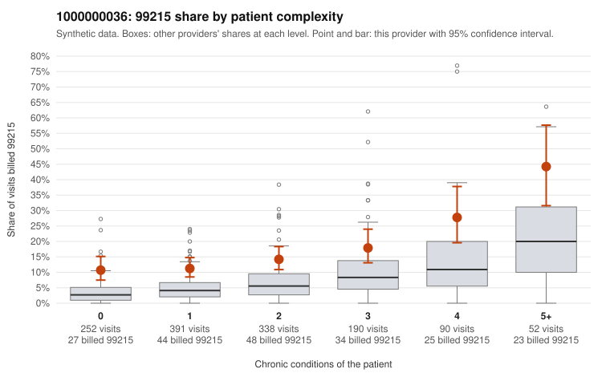

# 1000000036: 1000000036: too few returned records to judge

**Leaning (advisory):** Inconclusive

## Why

1000000036 billed 99215 on 15.3% of 1,313 claims against an expected 5.3% given patient complexity (risk-adjusted score 5.57; plain z-score vs peers 1.63). 35% of this provider's 99215 claims were on patients with 0 or 1 chronic conditions. Records came back for 44 claims. Of 17 documented 99215 claims, 4 (24%) were documented below the billed level, against 33% for the comparison providers. Note checks on 44 returned notes (share showing each sign): problems 23%, late 2%, unsigned 0%, data 4%. No audit trail was received. 2 of 33 notes claiming moderate-or-higher data reviewed had no lab or test line on the claim. The evidence does not support a call either way yet. Examples: C0019244: billed 99215; documented MDM level moderate, 37 minutes. C0019513: billed 99215; documented MDM level moderate, minutes not recorded. C0018935: billed 99215, patient aged 28 with 0 chronic condition(s). C0018956: billed 99215, patient aged 32 with 1 chronic condition(s) (hyperlipidemia).

## Evidence chart

## Cited claims

`C0019244`, `C0019513`, `C0018935`, `C0018956`

## Suggested next steps

- 44 charts came back but do not settle it: request a targeted sample of 99215 charts, starting with C0019244, C0019513, C0018935.
- Re-check after the targeted charts arrive; do not call upcoding or a sicker panel on this evidence alone.

---
Citations checked: 4/4 valid. Synthetic data. The leaning is advisory; the flag comes from the statistical screen, and no clinical documentation is available beyond the sampled records-review facts shown in the packet.
