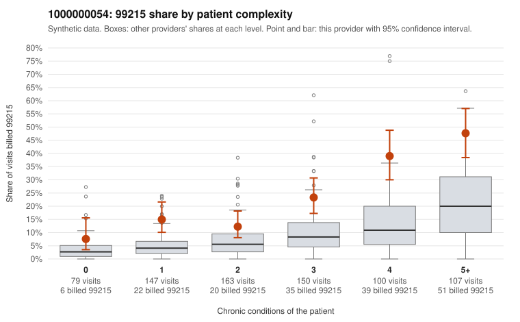

# 1000000054: 1000000054: too few returned records to judge

**Leaning (advisory):** Inconclusive

## Why

1000000054 billed 99215 on 23.2% of 746 claims against an expected 7.6% given patient complexity (risk-adjusted score 5.51; plain z-score vs peers 3.13). 16% of this provider's 99215 claims were on patients with 0 or 1 chronic conditions. Records came back for 45 claims. Of 23 documented 99215 claims, 3 (13%) were documented below the billed level, against 33% for the comparison providers. Note checks on 45 returned notes (share showing each sign): problems 16%, late 7%, unsigned 0%, data 2%. No audit trail was received. 3 of 43 notes claiming moderate-or-higher data reviewed had no lab or test line on the claim. The evidence does not support a call either way yet. Examples: C0028382: billed 99215; documented MDM level moderate, 32 minutes. C0028585: billed 99215, patient aged 58 with 1 chronic condition(s) (obesity); documented MDM level moderate, 35 minutes. C0028360: billed 99215, patient aged 59 with 1 chronic condition(s) (depression). C0028389: billed 99215, patient aged 46 with 1 chronic condition(s) (hyperlipidemia).

## Evidence chart

## Cited claims

`C0028382`, `C0028585`, `C0028360`, `C0028389`

## Suggested next steps

- 45 charts came back but do not settle it: request a targeted sample of 99215 charts, starting with C0028382, C0028585, C0028360.
- Re-check after the targeted charts arrive; do not call upcoding or a sicker panel on this evidence alone.

---
Citations checked: 4/4 valid. Synthetic data. The leaning is advisory; the flag comes from the statistical screen, and no clinical documentation is available beyond the sampled records-review facts shown in the packet.
