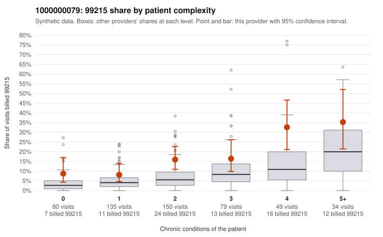

# 1000000079: 1000000079: too few returned records to judge

**Leaning (advisory):** Inconclusive

## Why

1000000079 billed 99215 on 15.8% of 527 claims against an expected 5.9% given patient complexity (risk-adjusted score 3.21; plain z-score vs peers 1.71). 22% of this provider's 99215 claims were on patients with 0 or 1 chronic conditions. Records came back for 30 claims. Of 5 documented 99215 claims, 4 (80%) were documented below the billed level, against 33% for the comparison providers. Note checks on 30 returned notes (share showing each sign): problems 13%, late 3%, unsigned 0%, data 0%. No audit trail was received. 0 of 20 notes claiming moderate-or-higher data reviewed had no lab or test line on the claim. The evidence does not support a call either way yet. Examples: C0042563: billed 99215; documented MDM level moderate, 33 minutes. C0042633: billed 99215; documented MDM level moderate, 30 minutes. C0042488: billed 99215, patient aged 51 with 1 chronic condition(s) (hypertension). C0042515: billed 99215, patient aged 71 with 0 chronic condition(s).

## Evidence chart

## Cited claims

`C0042563`, `C0042633`, `C0042488`, `C0042515`

## Suggested next steps

- 30 charts came back but do not settle it: request a targeted sample of 99215 charts, starting with C0042563, C0042633, C0042488.
- Re-check after the targeted charts arrive; do not call upcoding or a sicker panel on this evidence alone.

---
Citations checked: 4/4 valid. Synthetic data. The leaning is advisory; the flag comes from the statistical screen, and no clinical documentation is available beyond the sampled records-review facts shown in the packet.
