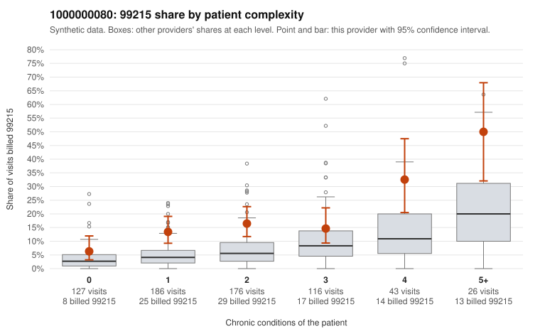

# 1000000080: 1000000080: too few returned records to judge

**Leaning (advisory):** Inconclusive

## Why

1000000080 billed 99215 on 15.7% of 674 claims against an expected 5.4% given patient complexity (risk-adjusted score 4.06; plain z-score vs peers 1.71). 31% of this provider's 99215 claims were on patients with 0 or 1 chronic conditions. Records came back for 30 claims. Of 6 documented 99215 claims, 2 (33%) were documented below the billed level, against 33% for the comparison providers. Note checks on 30 returned notes (share showing each sign): problems 23%, late 3%, unsigned 0%, data 0%. No audit trail was received. 2 of 26 notes claiming moderate-or-higher data reviewed had no lab or test line on the claim. The evidence does not support a call either way yet. Examples: C0043391: billed 99215; documented MDM level low, minutes not recorded. C0043448: billed 99215, patient aged 57 with 0 chronic condition(s); documented MDM level moderate, 38 minutes. C0043078: billed 99215, patient aged 71 with 1 chronic condition(s) (COPD). C0043084: billed 99215, patient aged 52 with 1 chronic condition(s) (hypertension); documented MDM level high, 42 minutes.

## Evidence chart

## Cited claims

`C0043391`, `C0043448`, `C0043078`, `C0043084`

## Suggested next steps

- 30 charts came back but do not settle it: request a targeted sample of 99215 charts, starting with C0043391, C0043448, C0043078.
- Re-check after the targeted charts arrive; do not call upcoding or a sicker panel on this evidence alone.

---
Citations checked: 4/4 valid. Synthetic data. The leaning is advisory; the flag comes from the statistical screen, and no clinical documentation is available beyond the sampled records-review facts shown in the packet.
