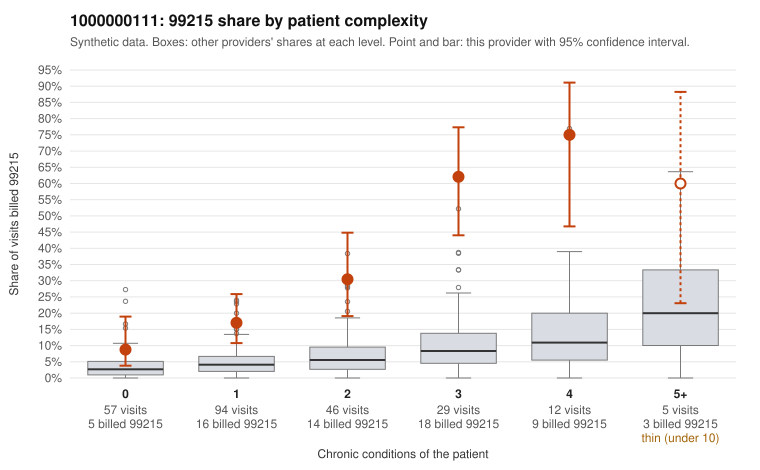

# 1000000111: 1000000111: too few returned records to judge

**Leaning (advisory):** Inconclusive

## Why

1000000111 billed 99215 on 26.7% of 243 claims against an expected 4.6% given patient complexity (risk-adjusted score 5.56; plain z-score vs peers 3.80). 32% of this provider's 99215 claims were on patients with 0 or 1 chronic conditions. Records came back for 45 claims. Of 27 documented 99215 claims, 6 (22%) were documented below the billed level, against 33% for the comparison providers. Note checks on 45 returned notes (share showing each sign): problems 24%, late 4%, unsigned 0%, data 4%. No audit trail was received. 2 of 40 notes claiming moderate-or-higher data reviewed had no lab or test line on the claim. The evidence does not support a call either way yet. Examples: C0059638: billed 99215, patient aged 50 with 1 chronic condition(s) (COPD); documented MDM level moderate, 39 minutes. C0059650: billed 99215; documented MDM level moderate, minutes not recorded. C0059634: billed 99215, patient aged 61 with 1 chronic condition(s) (hypertension).

## Evidence chart

## Cited claims

`C0059638`, `C0059650`, `C0059634`

## Suggested next steps

- 45 charts came back but do not settle it: request a targeted sample of 99215 charts, starting with C0059638, C0059650, C0059634.
- Re-check after the targeted charts arrive; do not call upcoding or a sicker panel on this evidence alone.

---
Citations checked: 3/3 valid. Synthetic data. The leaning is advisory; the flag comes from the statistical screen, and no clinical documentation is available beyond the sampled records-review facts shown in the packet.
