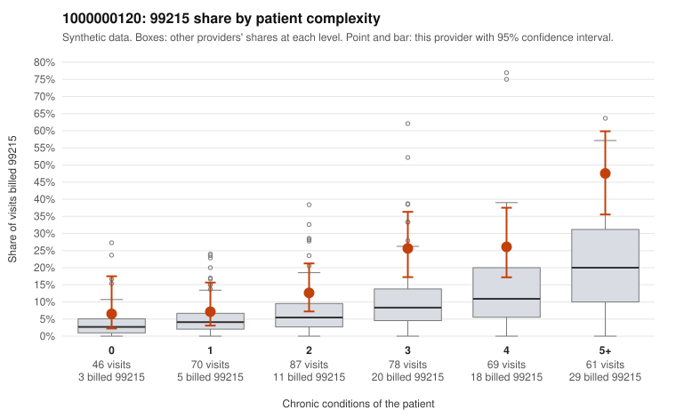

# 1000000120: 1000000120: documented 99215 claims mostly support the level billed (12% below)

**Leaning (advisory):** Pattern consistent with a high-acuity panel

## Why

1000000120 billed 99215 on 20.9% of 411 claims against an expected 7.8% given patient complexity (risk-adjusted score 3.36; plain z-score vs peers 2.69). 9% of this provider's 99215 claims were on patients with 0 or 1 chronic conditions. Records came back for 45 claims. Of 17 documented 99215 claims, 2 (12%) were documented below the billed level, against 33% for the comparison providers. Note checks on 45 returned notes (share showing each sign): problems 11%, late 4%, unsigned 0%, data 4%. No audit trail was received. 5 of 37 notes claiming moderate-or-higher data reviewed had no lab or test line on the claim. This pattern is consistent with a high-acuity panel. The sampled documentation supports the billed level. Examples: C0063344: billed 99215; documented MDM level high, 45 minutes. C0063351: billed 99215; documented MDM level high, 31 minutes. C0063562: billed 99215; documented MDM level high, minutes not recorded. C0063330: billed 99215, patient aged 67 with 4 chronic condition(s) (type 2 diabetes;hypertension;heart failure;chronic kidney disease). C0063364: billed 99215, patient aged 87 with 5 chronic condition(s) (type 2 diabetes;obesity;depression;hypertension;osteoarthritis).

## Evidence chart

## Cited claims

`C0063344`, `C0063351`, `C0063562`, `C0063330`, `C0063364`

## Suggested next steps

- Do not pursue recovery on this evidence: 45 charts came back and they support the level billed (2 of 17 documented 99215 claims below the billed level).
- Revisit if the 99215 share keeps rising against peers or a larger sample shows unsupported claims.

---
Citations checked: 5/5 valid. Synthetic data. The leaning is advisory; the flag comes from the statistical screen, and no clinical documentation is available beyond the sampled records-review facts shown in the packet.
