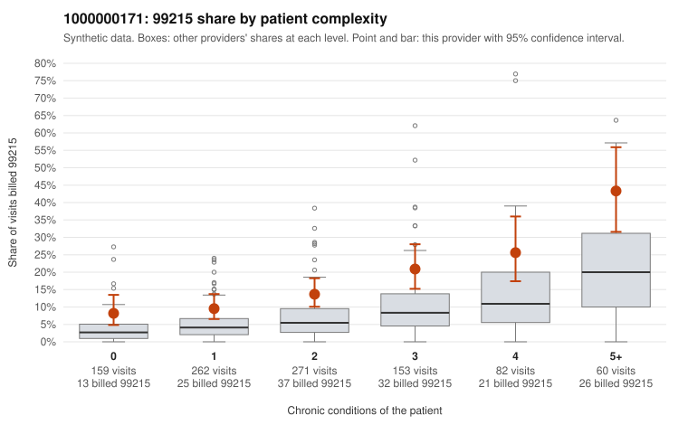

# 1000000171: 1000000171: too few returned records to judge

**Leaning (advisory):** Inconclusive

## Why

1000000171 billed 99215 on 15.6% of 987 claims against an expected 5.8% given patient complexity (risk-adjusted score 4.43; plain z-score vs peers 1.69). 25% of this provider's 99215 claims were on patients with 0 or 1 chronic conditions. Records came back for 30 claims. Of 6 documented 99215 claims, 3 (50%) were documented below the billed level, against 33% for the comparison providers. Note checks on 30 returned notes (share showing each sign): problems 20%, late 3%, unsigned 0%, data 3%. No audit trail was received. 4 of 24 notes claiming moderate-or-higher data reviewed had no lab or test line on the claim. The evidence does not support a call either way yet. Examples: C0086332: billed 99215; documented MDM level moderate, 35 minutes. C0086645: billed 99215; documented MDM level moderate, 26 minutes. C0086335: billed 99215, patient aged 62 with 1 chronic condition(s) (hypothyroidism). C0086338: billed 99215, patient aged 34 with 0 chronic condition(s).

## Evidence chart

## Cited claims

`C0086332`, `C0086645`, `C0086335`, `C0086338`

## Suggested next steps

- 30 charts came back but do not settle it: request a targeted sample of 99215 charts, starting with C0086332, C0086645, C0086335.
- Re-check after the targeted charts arrive; do not call upcoding or a sicker panel on this evidence alone.

---
Citations checked: 4/4 valid. Synthetic data. The leaning is advisory; the flag comes from the statistical screen, and no clinical documentation is available beyond the sampled records-review facts shown in the packet.
