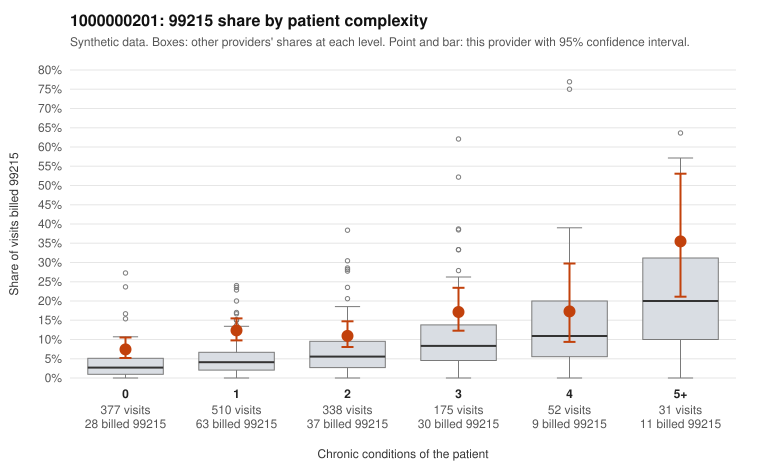

# 1000000201: 1000000201: too few returned records to judge

**Leaning (advisory):** Inconclusive

## Why

1000000201 billed 99215 on 12.0% of 1,483 claims against an expected 4.6% given patient complexity (risk-adjusted score 4.68; plain z-score vs peers 1.00). 51% of this provider's 99215 claims were on patients with 0 or 1 chronic conditions. Records came back for 24 claims. Of 4 documented 99215 claims, 4 (100%) were documented below the billed level, against 33% for the comparison providers. Note checks on 24 returned notes (share showing each sign): problems 21%, late 12%, unsigned 0%, data 4%. No audit trail was received. 1 of 16 notes claiming moderate-or-higher data reviewed had no lab or test line on the claim. The evidence does not support a call either way yet. Examples: C0106180: billed 99215; documented MDM level moderate, minutes not recorded. C0106445: billed 99215; documented MDM level moderate, 33 minutes. C0106089: billed 99215, patient aged 65 with 1 chronic condition(s) (depression). C0106152: billed 99215, patient aged 52 with 0 chronic condition(s).

## Evidence chart

## Cited claims

`C0106180`, `C0106445`, `C0106089`, `C0106152`

## Suggested next steps

- 24 charts came back but do not settle it: request a targeted sample of 99215 charts, starting with C0106180, C0106445, C0106089.
- Re-check after the targeted charts arrive; do not call upcoding or a sicker panel on this evidence alone.

---
Citations checked: 4/4 valid. Synthetic data. The leaning is advisory; the flag comes from the statistical screen, and no clinical documentation is available beyond the sampled records-review facts shown in the packet.
