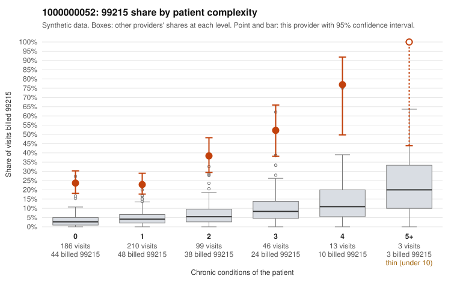

# Payment Integrity dossier: 1000000052

> Draft for human review. Statistical and records-sample evidence only; not a finding. Compliance or legal review is needed before any provider contact, notice or recoupment.

## Provider overview

| | |
|---|---|
| Specialty / state | Family Practice, GA (synthetic) |
| Claims / patients | 557 / 350 |
| Billed mix (99211 to 99215) | 1 / 0 / 44 / 345 / 167 |
| 99215 share | 30.0% |
| Expected 99215 share given patient complexity | 3.9% |
| Screen scores | z vs peers 4.41; risk-adjusted 10.93; flagged by eb_ratio_t |

## Case summary (advisory)

**1000000052: 2 of 25 documented 99215 claims (8%) are documented below the billed level**

Leaning: pattern consistent with upcoding. Citations checked: 5/5 valid.

1000000052 billed 99215 on 30.0% of 557 claims against an expected 3.9% given patient complexity (risk-adjusted score 10.93; plain z-score vs peers 4.41). 55% of this provider's 99215 claims were on patients with 0 or 1 chronic conditions. Records came back for 44 claims. Of 25 documented 99215 claims, 2 (8%) were documented below the billed level, against 33% for the comparison providers. Note checks on 44 returned notes (share showing each sign): problems 46%, late 27%, unsigned 0%, data 11%. No audit trail was received. 6 of 40 notes claiming moderate-or-higher data reviewed had no lab or test line on the claim. This pattern is consistent with upcoding. It is a reason to review the records, not a finding. Examples: C0027354: billed 99215; documented MDM level moderate, minutes not recorded. C0027759: billed 99215; documented MDM level moderate, 39 minutes. C0027213: billed 99215, patient aged 60 with 1 chronic condition(s) (type 2 diabetes). C0027280: billed 99215, patient aged 36 with 1 chronic condition(s) (chronic kidney disease). C0027294: billed 99215, patient aged 26 with 0 chronic condition(s).

## Evidence chart

## Records-review sample so far

Documentation is on file for 44 claims (8% of this provider's claims).

| Billed | Documented | Documentation below billed level | Rate | All-provider rate |
|---|---|---|---|---|
| 99213 | 2 | 0 | 0.0% | 4.8% |
| 99214 | 17 | 2 | 11.8% | 10.5% |
| 99215 | 25 | 2 | 8.0% | 33.3% |

## Recommended next steps for Payment Integrity

1. Request records for the sampled claims in `record_request_list.csv` (49 claims across 99215).
2. Review the records against E/M documentation rules and record the supported level for each claim.
3. Run the overpayment estimator on the reviewed sample (`sampling_plan.md` explains how).
4. Notice, appeal rights, recoupment, education or corrective action, and any referral are decisions for the PI team, compliance and counsel. Nothing here drafts those.

Suggested follow-ups from the case summary:

- Request the full charts for C0027354, C0027759, C0027213 and have a certified coder re-score each against the current E/M rules (medical decision making or total time).
- If the re-scoring confirms the pattern, review the random sample in the recovery packet's sampling plan before any overpayment estimate; do not extrapolate from a targeted sample.
- Look at the notes themselves: 46% address fewer problems than their level implies and 27% were signed late; request the audit trail for C0027354, C0027759, C0027213.

## Limits

- Synthetic data; no real claims or providers.
- The leaning is advisory. The flag comes from the statistical screen; the summary explains it.
- The records-review sample is partial and was simulated for this project.
- Allowed amounts are GA Family Practice averages from a public CMS file, not this provider's actual payments.
