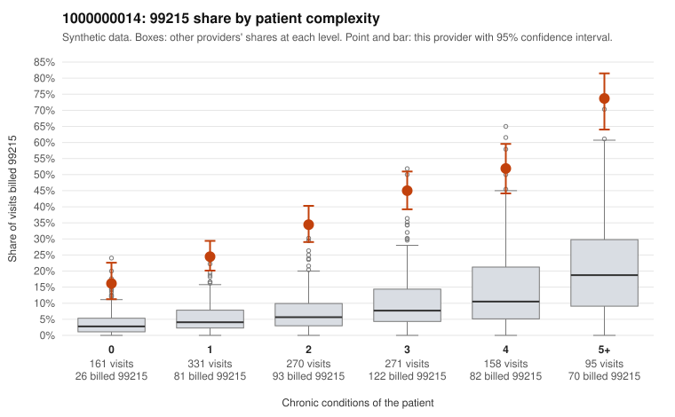

# 1000000014: 1000000014: too few returned records to judge

**Leaning (advisory):** Inconclusive

## Why

1000000014 billed 99215 on 36.9% of 1,286 claims against an expected 6.8% given patient complexity (risk-adjusted score 17.62; plain z-score vs peers 4.32). 23% of this provider's 99215 claims were on patients with 0 or 1 chronic conditions. Records came back for 30 claims. Of 13 documented 99215 claims, 1 (8%) were documented below the billed level, against 39% for the comparison providers. Note checks on 30 returned notes (share showing each sign): problems 20%, late 3%, unsigned 0%, data 7%. No audit trail was received. 4 of 25 notes claiming moderate-or-higher data reviewed had no lab or test line on the claim. The evidence does not support a call either way yet. Examples: C0006236: billed 99215; documented MDM level moderate, minutes not recorded. C0005026: billed 99215, patient aged 38 with 0 chronic condition(s). C0005097: billed 99215, patient aged 41 with 0 chronic condition(s).

## Evidence chart

## Cited claims

`C0006236`, `C0005026`, `C0005097`

## Suggested next steps

- 30 charts came back but do not settle it: request a targeted sample of 99215 charts, starting with C0006236, C0005026, C0005097.
- Re-check after the targeted charts arrive; do not call upcoding or a sicker panel on this evidence alone.

---
Citations checked: 3/3 valid. Synthetic data. The leaning is advisory; the flag comes from the statistical screen, and no clinical documentation is available beyond the sampled records-review facts shown in the packet.
