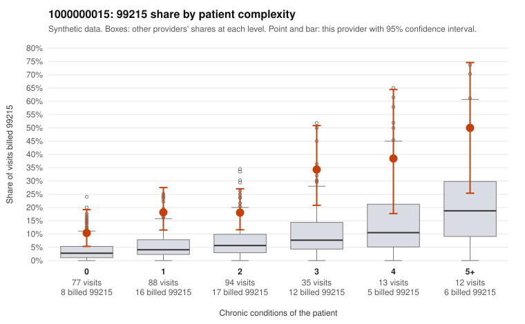

# 1000000015: 1000000015: too few returned records to judge

**Leaning (advisory):** Inconclusive

## Why

1000000015 billed 99215 on 20.1% of 319 claims against an expected 5.4% given patient complexity (risk-adjusted score 4.73; plain z-score vs peers 1.86). 38% of this provider's 99215 claims were on patients with 0 or 1 chronic conditions. Records came back for 45 claims. Of 20 documented 99215 claims, 4 (20%) were documented below the billed level, against 39% for the comparison providers. Note checks on 45 returned notes (share showing each sign): problems 33%, late 2%, unsigned 0%, data 11%. No audit trail was received. 6 of 35 notes claiming moderate-or-higher data reviewed had no lab or test line on the claim. The evidence does not support a call either way yet. Examples: C0006421: billed 99215, patient aged 41 with 1 chronic condition(s) (hypertension); documented MDM level moderate, 37 minutes. C0006545: billed 99215, patient aged 77 with 4 chronic condition(s) (hypothyroidism;obesity;hyperlipidemia;osteoarthritis); documented MDM level moderate, minutes not recorded. C0006400: billed 99215, patient aged 70 with 1 chronic condition(s) (depression). C0006412: billed 99215, patient aged 58 with 1 chronic condition(s) (chronic kidney disease).

## Evidence chart

## Cited claims

`C0006421`, `C0006545`, `C0006400`, `C0006412`

## Suggested next steps

- 45 charts came back but do not settle it: request a targeted sample of 99215 charts, starting with C0006421, C0006545, C0006400.
- Re-check after the targeted charts arrive; do not call upcoding or a sicker panel on this evidence alone.

---
Citations checked: 4/4 valid. Synthetic data. The leaning is advisory; the flag comes from the statistical screen, and no clinical documentation is available beyond the sampled records-review facts shown in the packet.
