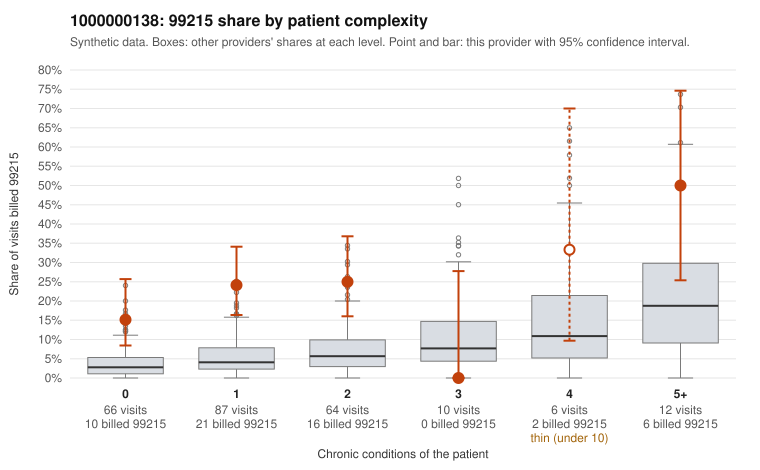

# 1000000138: 1000000138: 0 of 9 documented 99215 claims (0%) are documented below the billed level

**Leaning (advisory):** Pattern consistent with upcoding

## Why

1000000138 billed 99215 on 22.4% of 245 claims against an expected 5.1% given patient complexity (risk-adjusted score 5.04; plain z-score vs peers 2.21). 56% of this provider's 99215 claims were on patients with 0 or 1 chronic conditions. Records came back for 30 claims. Of 9 documented 99215 claims, 0 (0%) were documented below the billed level, against 39% for the comparison providers. Note checks on 30 returned notes (share showing each sign): problems 47%, late 17%, unsigned 0%, data 7%, bulk created 13%, paste heavy 13%. 2 of 24 notes claiming moderate-or-higher data reviewed had no lab or test line on the claim. This pattern is consistent with upcoding. It is a reason to review the records, not a finding. Examples: C0069945: billed 99215, patient aged 43 with 0 chronic condition(s). C0069952: billed 99215, patient aged 71 with 1 chronic condition(s) (obesity). C0069955: billed 99215, patient aged 34 with 1 chronic condition(s) (hyperlipidemia).

## Evidence chart

## Cited claims

`C0069945`, `C0069952`, `C0069955`

## Suggested next steps

- Request the full charts for C0069945, C0069952, C0069955 and have a certified coder re-score each against the current E/M rules (medical decision making or total time).
- If the re-scoring confirms the pattern, review the random sample in the recovery packet's sampling plan before any overpayment estimate; do not extrapolate from a targeted sample.
- Look at the notes themselves: 47% address fewer problems than their level implies and 17% were signed late; request the audit trail for C0069945, C0069952, C0069955.

---
Citations checked: 3/3 valid. Synthetic data. The leaning is advisory; the flag comes from the statistical screen, and no clinical documentation is available beyond the sampled records-review facts shown in the packet.
