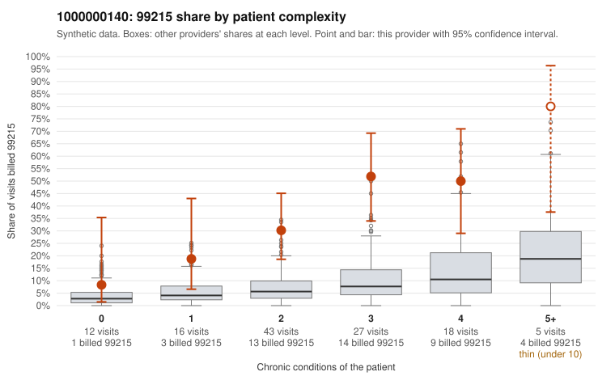

# 1000000140: 1000000140: too few returned records to judge

**Leaning (advisory):** Inconclusive

## Why

1000000140 billed 99215 on 36.4% of 121 claims against an expected 6.8% given patient complexity (risk-adjusted score 5.25; plain z-score vs peers 4.24). 9% of this provider's 99215 claims were on patients with 0 or 1 chronic conditions. Records came back for 45 claims. Of 22 documented 99215 claims, 1 (4%) were documented below the billed level, against 39% for the comparison providers. Note checks on 45 returned notes (share showing each sign): problems 13%, late 7%, unsigned 0%, data 4%. No audit trail was received. 2 of 36 notes claiming moderate-or-higher data reviewed had no lab or test line on the claim. The evidence does not support a call either way yet. Examples: C0070478: billed 99215; documented MDM level moderate, minutes not recorded. C0070413: billed 99215, patient aged 40 with 0 chronic condition(s). C0070450: billed 99215, patient aged 24 with 1 chronic condition(s) (obesity).

## Evidence chart

## Cited claims

`C0070478`, `C0070413`, `C0070450`

## Suggested next steps

- 45 charts came back but do not settle it: request a targeted sample of 99215 charts, starting with C0070478, C0070413, C0070450.
- Re-check after the targeted charts arrive; do not call upcoding or a sicker panel on this evidence alone.

---
Citations checked: 3/3 valid. Synthetic data. The leaning is advisory; the flag comes from the statistical screen, and no clinical documentation is available beyond the sampled records-review facts shown in the packet.
