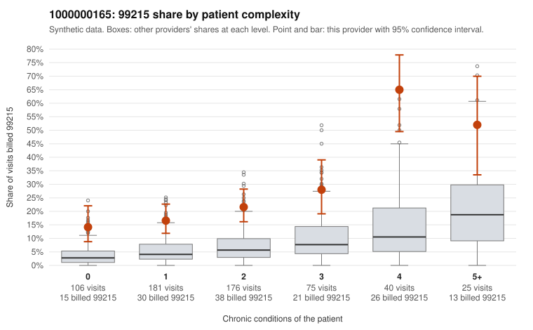

# 1000000165: 1000000165: too few returned records to judge

**Leaning (advisory):** Inconclusive

## Why

1000000165 billed 99215 on 23.7% of 603 claims against an expected 5.7% given patient complexity (risk-adjusted score 7.76; plain z-score vs peers 2.39). 31% of this provider's 99215 claims were on patients with 0 or 1 chronic conditions. Records came back for 30 claims. Of 8 documented 99215 claims, 1 (12%) were documented below the billed level, against 39% for the comparison providers. Note checks on 30 returned notes (share showing each sign): problems 37%, late 7%, unsigned 0%, data 0%. No audit trail was received. 1 of 19 notes claiming moderate-or-higher data reviewed had no lab or test line on the claim. The evidence does not support a call either way yet. Examples: C0086500: billed 99215; documented MDM level moderate, 38 minutes. C0086060: billed 99215, patient aged 37 with 0 chronic condition(s). C0086072: billed 99215, patient aged 64 with 1 chronic condition(s) (osteoarthritis).

## Evidence chart

## Cited claims

`C0086500`, `C0086060`, `C0086072`

## Suggested next steps

- 30 charts came back but do not settle it: request a targeted sample of 99215 charts, starting with C0086500, C0086060, C0086072.
- Re-check after the targeted charts arrive; do not call upcoding or a sicker panel on this evidence alone.

---
Citations checked: 3/3 valid. Synthetic data. The leaning is advisory; the flag comes from the statistical screen, and no clinical documentation is available beyond the sampled records-review facts shown in the packet.
