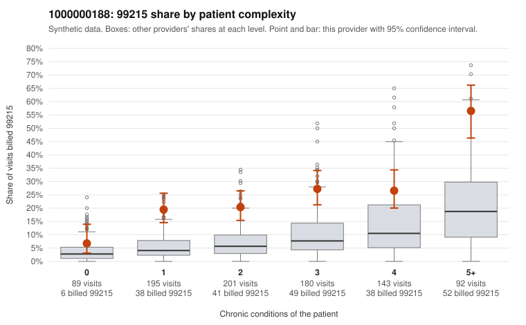

# 1000000188: 1000000188: too few returned records to judge

**Leaning (advisory):** Inconclusive

## Why

1000000188 billed 99215 on 24.9% of 900 claims against an expected 7.4% given patient complexity (risk-adjusted score 8.22; plain z-score vs peers 2.56). 20% of this provider's 99215 claims were on patients with 0 or 1 chronic conditions. Records came back for 30 claims. Of 9 documented 99215 claims, 0 (0%) were documented below the billed level, against 39% for the comparison providers. Note checks on 30 returned notes (share showing each sign): problems 20%, late 20%, unsigned 0%, data 17%. No audit trail was received. 6 of 25 notes claiming moderate-or-higher data reviewed had no lab or test line on the claim. The evidence does not support a call either way yet. Examples: C0096151: billed 99214; documented MDM level low, 20 minutes. C0095661: billed 99215, patient aged 22 with 1 chronic condition(s) (hypertension). C0095692: billed 99215, patient aged 65 with 1 chronic condition(s) (hypertension).

## Evidence chart

## Cited claims

`C0096151`, `C0095661`, `C0095692`

## Suggested next steps

- 30 charts came back but do not settle it: request a targeted sample of 99215 charts, starting with C0096151, C0095661, C0095692.
- Re-check after the targeted charts arrive; do not call upcoding or a sicker panel on this evidence alone.

---
Citations checked: 3/3 valid. Synthetic data. The leaning is advisory; the flag comes from the statistical screen, and no clinical documentation is available beyond the sampled records-review facts shown in the packet.
