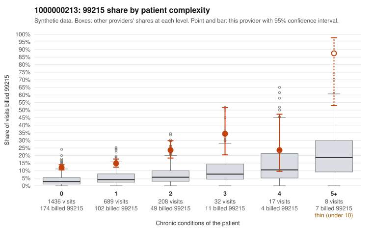

# 1000000213: 1000000213: too few returned records to judge

**Leaning (advisory):** Inconclusive

## Why

1000000213 billed 99215 on 14.5% of 2,390 claims against an expected 3.6% given patient complexity (risk-adjusted score 11.54; plain z-score vs peers 1.05). 80% of this provider's 99215 claims were on patients with 0 or 1 chronic conditions. Records came back for 29 claims. Of 6 documented 99215 claims, 4 (67%) were documented below the billed level, against 39% for the comparison providers. Note checks on 29 returned notes (share showing each sign): problems 48%, late 3%, unsigned 0%, data 3%, bulk created 0%, paste heavy 3%. 1 of 20 notes claiming moderate-or-higher data reviewed had no lab or test line on the claim. The evidence does not support a call either way yet. Examples: C0108460: billed 99215; documented MDM level moderate, 26 minutes. C0109467: billed 99215; documented MDM level moderate, 38 minutes. C0108416: billed 99215, patient aged 36 with 0 chronic condition(s). C0108766: billed 99215, patient aged 77 with 1 chronic condition(s) (osteoarthritis).

## Evidence chart

## Cited claims

`C0108460`, `C0109467`, `C0108416`, `C0108766`

## Suggested next steps

- 29 charts came back but do not settle it: request a targeted sample of 99215 charts, starting with C0108460, C0109467, C0108416.
- Re-check after the targeted charts arrive; do not call upcoding or a sicker panel on this evidence alone.

---
Citations checked: 4/4 valid. Synthetic data. The leaning is advisory; the flag comes from the statistical screen, and no clinical documentation is available beyond the sampled records-review facts shown in the packet.
