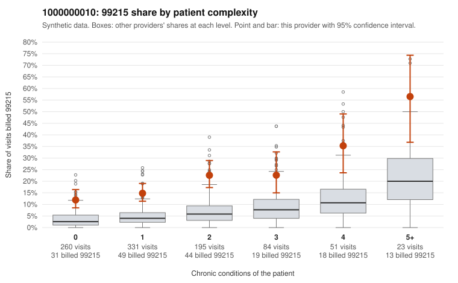

# 1000000010: 1000000010: too few returned records to judge

**Leaning (advisory):** Inconclusive

## Why

1000000010 billed 99215 on 18.4% of 944 claims against an expected 4.7% given patient complexity (risk-adjusted score 8.53; plain z-score vs peers 1.97). 46% of this provider's 99215 claims were on patients with 0 or 1 chronic conditions. Records came back for 30 claims. Of 6 documented 99215 claims, 0 (0%) were documented below the billed level, against 43% for the comparison providers. Note checks on 30 returned notes (share showing each sign): problems 33%, late 17%, unsigned 0%, data 7%. No audit trail was received. 2 of 22 notes claiming moderate-or-higher data reviewed had no lab or test line on the claim. The evidence does not support a call either way yet. Examples: C0003029: billed 99214; documented MDM level low, minutes not recorded. C0002489: billed 99215, patient aged 26 with 1 chronic condition(s) (hyperlipidemia). C0002553: billed 99215, patient aged 53 with 1 chronic condition(s) (atrial fibrillation).

## Evidence chart

## Cited claims

`C0003029`, `C0002489`, `C0002553`

## Suggested next steps

- 30 charts came back but do not settle it: request a targeted sample of 99215 charts, starting with C0003029, C0002489, C0002553.
- Re-check after the targeted charts arrive; do not call upcoding or a sicker panel on this evidence alone.

---
Citations checked: 3/3 valid. Synthetic data. The leaning is advisory; the flag comes from the statistical screen, and no clinical documentation is available beyond the sampled records-review facts shown in the packet.
