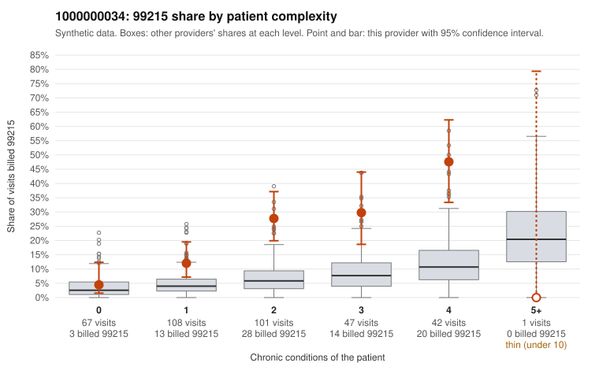

# 1000000034: 1000000034: too few returned records to judge

**Leaning (advisory):** Inconclusive

## Why

1000000034 billed 99215 on 21.3% of 366 claims against an expected 5.1% given patient complexity (risk-adjusted score 5.93; plain z-score vs peers 2.47). 21% of this provider's 99215 claims were on patients with 0 or 1 chronic conditions. Records came back for 45 claims. Of 20 documented 99215 claims, 2 (10%) were documented below the billed level, against 43% for the comparison providers. Note checks on 45 returned notes (share showing each sign): problems 20%, late 2%, unsigned 0%, data 11%. No audit trail was received. 6 of 38 notes claiming moderate-or-higher data reviewed had no lab or test line on the claim. The evidence does not support a call either way yet. Examples: C0018904: billed 99215; documented MDM level moderate, 24 minutes. C0019162: billed 99215; documented MDM level moderate, 34 minutes. C0018916: billed 99215, patient aged 59 with 0 chronic condition(s). C0018950: billed 99215, patient aged 62 with 1 chronic condition(s) (COPD).

## Evidence chart

## Cited claims

`C0018904`, `C0019162`, `C0018916`, `C0018950`

## Suggested next steps

- 45 charts came back but do not settle it: request a targeted sample of 99215 charts, starting with C0018904, C0019162, C0018916.
- Re-check after the targeted charts arrive; do not call upcoding or a sicker panel on this evidence alone.

---
Citations checked: 4/4 valid. Synthetic data. The leaning is advisory; the flag comes from the statistical screen, and no clinical documentation is available beyond the sampled records-review facts shown in the packet.
