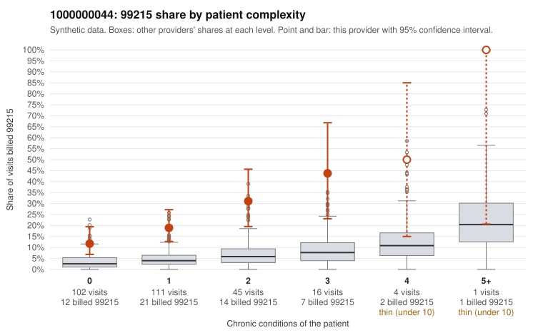

# 1000000044: 1000000044: too few returned records to judge

**Leaning (advisory):** Inconclusive

## Why

1000000044 billed 99215 on 20.4% of 279 claims against an expected 3.8% given patient complexity (risk-adjusted score 6.07; plain z-score vs peers 2.32). 58% of this provider's 99215 claims were on patients with 0 or 1 chronic conditions. Records came back for 29 claims. Of 7 documented 99215 claims, 1 (14%) were documented below the billed level, against 43% for the comparison providers. Note checks on 29 returned notes (share showing each sign): problems 55%, late 3%, unsigned 0%, data 0%, bulk created 0%, paste heavy 0%. 3 of 24 notes claiming moderate-or-higher data reviewed had no lab or test line on the claim. The evidence does not support a call either way yet. Examples: C0028510: billed 99215; documented MDM level moderate, minutes not recorded. C0028491: billed 99215, patient aged 50 with 0 chronic condition(s). C0028498: billed 99215, patient aged 31 with 1 chronic condition(s) (type 2 diabetes).

## Evidence chart

## Cited claims

`C0028510`, `C0028491`, `C0028498`

## Suggested next steps

- 29 charts came back but do not settle it: request a targeted sample of 99215 charts, starting with C0028510, C0028491, C0028498.
- Re-check after the targeted charts arrive; do not call upcoding or a sicker panel on this evidence alone.

---
Citations checked: 3/3 valid. Synthetic data. The leaning is advisory; the flag comes from the statistical screen, and no clinical documentation is available beyond the sampled records-review facts shown in the packet.
