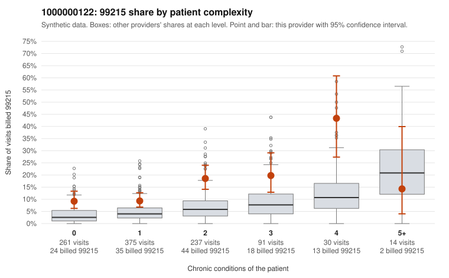

# 1000000122: 1000000122: too few returned records to judge

**Leaning (advisory):** Inconclusive

## Why

1000000122 billed 99215 on 13.5% of 1,008 claims against an expected 4.5% given patient complexity (risk-adjusted score 5.87; plain z-score vs peers 1.12). 43% of this provider's 99215 claims were on patients with 0 or 1 chronic conditions. Records came back for 45 claims. Of 20 documented 99215 claims, 3 (15%) were documented below the billed level, against 43% for the comparison providers. Note checks on 45 returned notes (share showing each sign): problems 27%, late 7%, unsigned 0%, data 9%. No audit trail was received. 5 of 37 notes claiming moderate-or-higher data reviewed had no lab or test line on the claim. The evidence does not support a call either way yet. Examples: C0068834: billed 99215; documented MDM level moderate, minutes not recorded. C0069252: billed 99215, patient aged 54 with 0 chronic condition(s); documented MDM level moderate, 34 minutes. C0068907: billed 99215, patient aged 37 with 0 chronic condition(s). C0068986: billed 99215, patient aged 56 with 1 chronic condition(s) (hypertension).

## Evidence chart

## Cited claims

`C0068834`, `C0069252`, `C0068907`, `C0068986`

## Suggested next steps

- 45 charts came back but do not settle it: request a targeted sample of 99215 charts, starting with C0068834, C0069252, C0068907.
- Re-check after the targeted charts arrive; do not call upcoding or a sicker panel on this evidence alone.

---
Citations checked: 4/4 valid. Synthetic data. The leaning is advisory; the flag comes from the statistical screen, and no clinical documentation is available beyond the sampled records-review facts shown in the packet.
