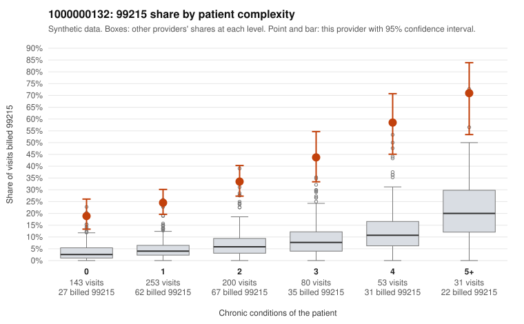

# 1000000132: 1000000132: too few returned records to judge

**Leaning (advisory):** Inconclusive

## Why

1000000132 billed 99215 on 32.1% of 760 claims against an expected 5.3% given patient complexity (risk-adjusted score 14.28; plain z-score vs peers 4.34). 36% of this provider's 99215 claims were on patients with 0 or 1 chronic conditions. Records came back for 29 claims. Of 9 documented 99215 claims, 1 (11%) were documented below the billed level, against 43% for the comparison providers. Note checks on 29 returned notes (share showing each sign): problems 31%, late 7%, unsigned 0%, data 3%. No audit trail was received. 3 of 23 notes claiming moderate-or-higher data reviewed had no lab or test line on the claim. The evidence does not support a call either way yet. Examples: C0077477: billed 99215; documented MDM level moderate, 20 minutes. C0077016: billed 99215, patient aged 75 with 0 chronic condition(s). C0077074: billed 99215, patient aged 60 with 0 chronic condition(s).

## Evidence chart

## Cited claims

`C0077477`, `C0077016`, `C0077074`

## Suggested next steps

- 29 charts came back but do not settle it: request a targeted sample of 99215 charts, starting with C0077477, C0077016, C0077074.
- Re-check after the targeted charts arrive; do not call upcoding or a sicker panel on this evidence alone.

---
Citations checked: 3/3 valid. Synthetic data. The leaning is advisory; the flag comes from the statistical screen, and no clinical documentation is available beyond the sampled records-review facts shown in the packet.
