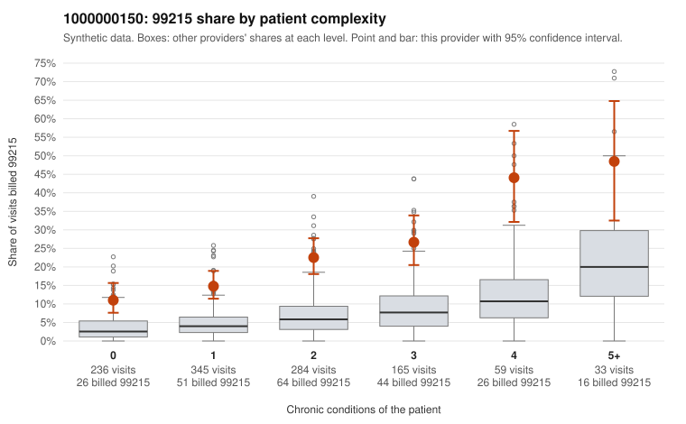

# 1000000150: 1000000150: too few returned records to judge

**Leaning (advisory):** Inconclusive

## Why

1000000150 billed 99215 on 20.2% of 1,122 claims against an expected 5.1% given patient complexity (risk-adjusted score 9.86; plain z-score vs peers 2.28). 34% of this provider's 99215 claims were on patients with 0 or 1 chronic conditions. Records came back for 30 claims. Of 7 documented 99215 claims, 1 (14%) were documented below the billed level, against 43% for the comparison providers. Note checks on 30 returned notes (share showing each sign): problems 20%, late 7%, unsigned 0%, data 3%. No audit trail was received. 1 of 20 notes claiming moderate-or-higher data reviewed had no lab or test line on the claim. The evidence does not support a call either way yet. Examples: C0089514: billed 99215; documented MDM level moderate, 39 minutes. C0088876: billed 99215, patient aged 27 with 1 chronic condition(s) (hyperlipidemia). C0088913: billed 99215, patient aged 65 with 0 chronic condition(s).

## Evidence chart

## Cited claims

`C0089514`, `C0088876`, `C0088913`

## Suggested next steps

- 30 charts came back but do not settle it: request a targeted sample of 99215 charts, starting with C0089514, C0088876, C0088913.
- Re-check after the targeted charts arrive; do not call upcoding or a sicker panel on this evidence alone.

---
Citations checked: 3/3 valid. Synthetic data. The leaning is advisory; the flag comes from the statistical screen, and no clinical documentation is available beyond the sampled records-review facts shown in the packet.
