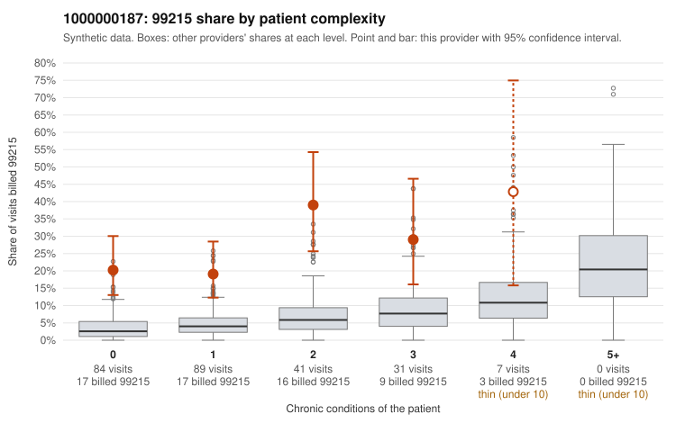

# 1000000187: 1000000187: too few returned records to judge

**Leaning (advisory):** Inconclusive

## Why

1000000187 billed 99215 on 24.6% of 252 claims against an expected 4.1% given patient complexity (risk-adjusted score 6.90; plain z-score vs peers 3.04). 55% of this provider's 99215 claims were on patients with 0 or 1 chronic conditions. Records came back for 29 claims. Of 6 documented 99215 claims, 0 (0%) were documented below the billed level, against 43% for the comparison providers. Note checks on 29 returned notes (share showing each sign): problems 34%, late 14%, unsigned 0%, data 14%. No audit trail was received. 5 of 22 notes claiming moderate-or-higher data reviewed had no lab or test line on the claim. The evidence does not support a call either way yet. Examples: C0110210: billed 99214; documented MDM level low, minutes not recorded. C0109960: billed 99215, patient aged 57 with 1 chronic condition(s) (heart failure). C0109975: billed 99215, patient aged 45 with 0 chronic condition(s).

## Evidence chart

## Cited claims

`C0110210`, `C0109960`, `C0109975`

## Suggested next steps

- 29 charts came back but do not settle it: request a targeted sample of 99215 charts, starting with C0110210, C0109960, C0109975.
- Re-check after the targeted charts arrive; do not call upcoding or a sicker panel on this evidence alone.

---
Citations checked: 3/3 valid. Synthetic data. The leaning is advisory; the flag comes from the statistical screen, and no clinical documentation is available beyond the sampled records-review facts shown in the packet.
