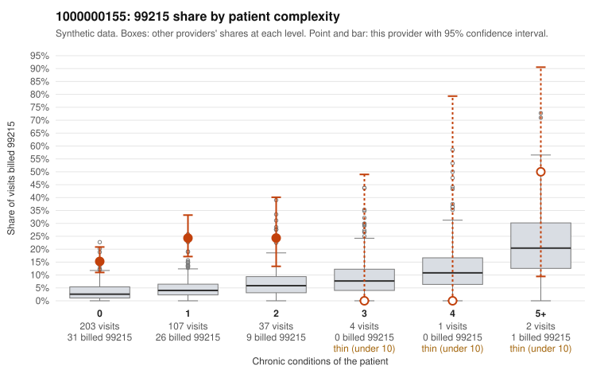

# Payment Integrity dossier: 1000000155

> Draft for human review. Statistical and records-sample evidence only; not a finding. Compliance or legal review is needed before any provider contact, notice or recoupment.

## Provider overview

| | |
|---|---|
| Specialty / state | Family Practice, GA (synthetic) |
| Claims / patients | 354 / 167 |
| Billed mix (99211 to 99215) | 4 / 8 / 90 / 185 / 67 |
| 99215 share | 18.9% |
| Expected 99215 share given patient complexity | 3.3% |
| Screen scores | z vs peers 2.06; risk-adjusted 6.95; flagged by eb_ratio |

## Case summary (advisory)

**1000000155: 8 of 9 documented 99215 claims (89%) are documented below the billed level**

Leaning: pattern consistent with upcoding. Citations checked: 6/6 valid.

1000000155 billed 99215 on 18.9% of 354 claims against an expected 3.3% given patient complexity (risk-adjusted score 6.95; plain z-score vs peers 2.06). 85% of this provider's 99215 claims were on patients with 0 or 1 chronic conditions. Records came back for 29 claims. Of 9 documented 99215 claims, 8 (89%) were documented below the billed level, against 43% for the comparison providers. Note checks on 29 returned notes (share showing each sign): problems 31%, late 10%, unsigned 0%, data 7%. No audit trail was received. 3 of 21 notes claiming moderate-or-higher data reviewed had no lab or test line on the claim. This pattern is consistent with upcoding. It is a reason to review the records, not a finding. Examples: C0093662: billed 99215; documented MDM level moderate, 31 minutes. C0093747: billed 99215; documented MDM level moderate, 35 minutes. C0093748: billed 99215; documented MDM level moderate, 24 minutes. C0093572: billed 99215, patient aged 31 with 1 chronic condition(s) (hypertension). C0093574: billed 99215, patient aged 20 with 1 chronic condition(s) (depression). C0093626: billed 99215, patient aged 63 with 1 chronic condition(s) (hypertension).

## Evidence chart

## Records-review sample so far

Documentation is on file for 29 claims (8% of this provider's claims).

| Billed | Documented | Documentation below billed level | Rate | All-provider rate |
|---|---|---|---|---|
| 99213 | 7 | 0 | 0.0% | 3.4% |
| 99214 | 12 | 2 | 16.7% | 6.1% |
| 99215 | 9 | 8 | 88.9% | 42.9% |

## Recommended next steps for Payment Integrity

1. Request records for the sampled claims in `record_request_list.csv` (34 claims across 99215).
2. Review the records against E/M documentation rules and record the supported level for each claim.
3. Run the overpayment estimator on the reviewed sample (`sampling_plan.md` explains how).
4. Notice, appeal rights, recoupment, education or corrective action, and any referral are decisions for the PI team, compliance and counsel. Nothing here drafts those.

Suggested follow-ups from the case summary:

- Request the full charts for C0093662, C0093747, C0093748 and have a certified coder re-score each against the current E/M rules (medical decision making or total time).
- If the re-scoring confirms the pattern, review the random sample in the recovery packet's sampling plan before any overpayment estimate; do not extrapolate from a targeted sample.
- Look at the notes themselves: 31% address fewer problems than their level implies and 10% were signed late; request the audit trail for C0093662, C0093747, C0093748.

## Limits

- Synthetic data; no real claims or providers.
- The leaning is advisory. The flag comes from the statistical screen; the summary explains it.
- The records-review sample is partial and was simulated for this project.
- Allowed amounts are GA Family Practice averages from a public CMS file, not this provider's actual payments.
