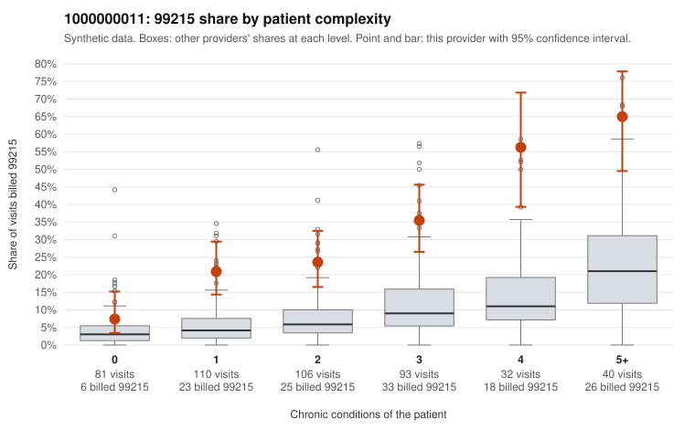

# 1000000011: 1000000011: too few returned records to judge

**Leaning (advisory):** Inconclusive

## Why

1000000011 billed 99215 on 28.4% of 462 claims against an expected 7.3% given patient complexity (risk-adjusted score 7.26; plain z-score vs peers 2.74). 22% of this provider's 99215 claims were on patients with 0 or 1 chronic conditions. Records came back for 16 claims. Of 8 documented 99215 claims, 2 (25%) were documented below the billed level, against 16% for the comparison providers. Note checks on 16 returned notes (share showing each sign): problems 6%, late 0%, unsigned 0%, data 0%. No audit trail was received. 0 of 11 notes claiming moderate-or-higher data reviewed had no lab or test line on the claim. The evidence does not support a call either way yet. Examples: C0002651: billed 99215, patient aged 49 with 1 chronic condition(s) (heart failure); documented MDM level moderate, minutes not recorded. C0002957: billed 99215; documented MDM level moderate, minutes not recorded. C0002635: billed 99215, patient aged 54 with 0 chronic condition(s).

## Evidence chart

## Cited claims

`C0002651`, `C0002957`, `C0002635`

## Suggested next steps

- 16 charts came back but do not settle it: request a targeted sample of 99215 charts, starting with C0002651, C0002957, C0002635.
- Re-check after the targeted charts arrive; do not call upcoding or a sicker panel on this evidence alone.

---
Citations checked: 3/3 valid. Synthetic data. The leaning is advisory; the flag comes from the statistical screen, and no clinical documentation is available beyond the sampled records-review facts shown in the packet.
