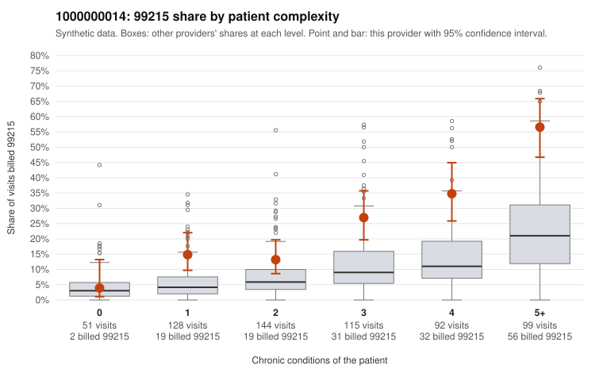

# 1000000014: 1000000014: documented 99215 claims mostly support the level billed (0% below)

**Leaning (advisory):** Pattern consistent with a high-acuity panel

## Why

1000000014 billed 99215 on 25.3% of 629 claims against an expected 9.1% given patient complexity (risk-adjusted score 5.86; plain z-score vs peers 2.34). 13% of this provider's 99215 claims were on patients with 0 or 1 chronic conditions. Records came back for 30 claims. Of 6 documented 99215 claims, 0 (0%) were documented below the billed level, against 16% for the comparison providers. Note checks on 30 returned notes (share showing each sign): problems 23%, late 0%, unsigned 0%, data 17%. No audit trail was received. 5 of 27 notes claiming moderate-or-higher data reviewed had no lab or test line on the claim. This pattern is consistent with a high-acuity panel. The sampled documentation supports the billed level. Examples: C0004133: billed 99215; documented MDM level high, minutes not recorded. C0004465: billed 99215; documented MDM level high, 53 minutes. C0004657: billed 99215; documented MDM level high, minutes not recorded. C0004073: billed 99215, patient aged 67 with 5 chronic condition(s) (hypothyroidism;obesity;hyperlipidemia;COPD;osteoarthritis). C0004109: billed 99215, patient aged 69 with 4 chronic condition(s) (type 2 diabetes;obesity;COPD;osteoarthritis).

## Evidence chart

## Cited claims

`C0004133`, `C0004465`, `C0004657`, `C0004073`, `C0004109`

## Suggested next steps

- Do not pursue recovery on this evidence: 30 charts came back and they support the level billed (0 of 6 documented 99215 claims below the billed level).
- Revisit if the 99215 share keeps rising against peers or a larger sample shows unsupported claims.

---
Citations checked: 5/5 valid. Synthetic data. The leaning is advisory; the flag comes from the statistical screen, and no clinical documentation is available beyond the sampled records-review facts shown in the packet.
