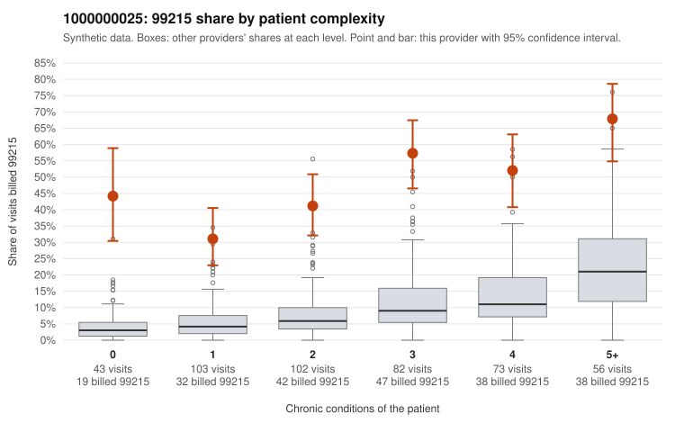

# 1000000025: 1000000025: too few returned records to judge

**Leaning (advisory):** Inconclusive

## Why

1000000025 billed 99215 on 47.1% of 459 claims against an expected 8.5% given patient complexity (risk-adjusted score 12.34; plain z-score vs peers 5.24). 24% of this provider's 99215 claims were on patients with 0 or 1 chronic conditions. Records came back for 30 claims. Of 13 documented 99215 claims, 4 (31%) were documented below the billed level, against 16% for the comparison providers. Note checks on 30 returned notes (share showing each sign): problems 17%, late 3%, unsigned 0%, data 3%. No audit trail was received. 2 of 24 notes claiming moderate-or-higher data reviewed had no lab or test line on the claim. The evidence does not support a call either way yet. Examples: C0009337: billed 99215; documented MDM level moderate, 35 minutes. C0009376: billed 99215; documented MDM level moderate, 34 minutes. C0009307: billed 99215, patient aged 57 with 0 chronic condition(s). C0009317: billed 99215, patient aged 32 with 1 chronic condition(s) (hypertension).

## Evidence chart

## Cited claims

`C0009337`, `C0009376`, `C0009307`, `C0009317`

## Suggested next steps

- 30 charts came back but do not settle it: request a targeted sample of 99215 charts, starting with C0009337, C0009376, C0009307.
- Re-check after the targeted charts arrive; do not call upcoding or a sicker panel on this evidence alone.

---
Citations checked: 4/4 valid. Synthetic data. The leaning is advisory; the flag comes from the statistical screen, and no clinical documentation is available beyond the sampled records-review facts shown in the packet.
