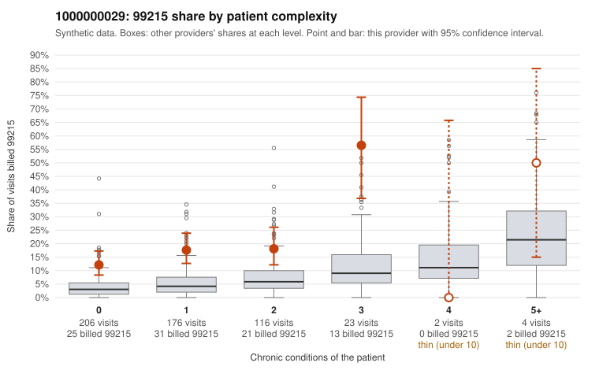

# 1000000029: 1000000029: 11 of 20 documented 99215 claims (55%) are documented below the billed level

**Leaning (advisory):** Pattern consistent with upcoding

## Why

1000000029 billed 99215 on 17.5% of 527 claims against an expected 4.4% given patient complexity (risk-adjusted score 6.02; plain z-score vs peers 1.29). 61% of this provider's 99215 claims were on patients with 0 or 1 chronic conditions. Records came back for 45 claims. Of 20 documented 99215 claims, 11 (55%) were documented below the billed level, against 16% for the comparison providers. Note checks on 45 returned notes (share showing each sign): problems 27%, late 4%, unsigned 0%, data 2%. No audit trail was received. 1 of 30 notes claiming moderate-or-higher data reviewed had no lab or test line on the claim. This pattern is consistent with upcoding. It is a reason to review the records, not a finding. Examples: C0010929: billed 99215, patient aged 70 with 5 chronic condition(s) (type 2 diabetes;obesity;hypertension;heart failure;COPD); documented MDM level moderate, 35 minutes. C0011003: billed 99215, patient aged 32 with 1 chronic condition(s) (asthma); documented MDM level moderate, 32 minutes. C0011169: billed 99215; documented MDM level moderate, 37 minutes. C0010836: billed 99215, patient aged 20 with 1 chronic condition(s) (depression). C0010862: billed 99215, patient aged 46 with 1 chronic condition(s) (asthma). C0010887: billed 99215, patient aged 53 with 1 chronic condition(s) (hyperlipidemia).

## Evidence chart

## Cited claims

`C0010929`, `C0011003`, `C0011169`, `C0010836`, `C0010862`, `C0010887`

## Suggested next steps

- Request the full charts for C0010929, C0011003, C0011169 and have a certified coder re-score each against the current E/M rules (medical decision making or total time).
- If the re-scoring confirms the pattern, review the random sample in the recovery packet's sampling plan before any overpayment estimate; do not extrapolate from a targeted sample.
- Look at the notes themselves: 27% address fewer problems than their level implies and 4% were signed late; request the audit trail for C0010929, C0011003, C0011169.

---
Citations checked: 6/6 valid. Synthetic data. The leaning is advisory; the flag comes from the statistical screen, and no clinical documentation is available beyond the sampled records-review facts shown in the packet.
