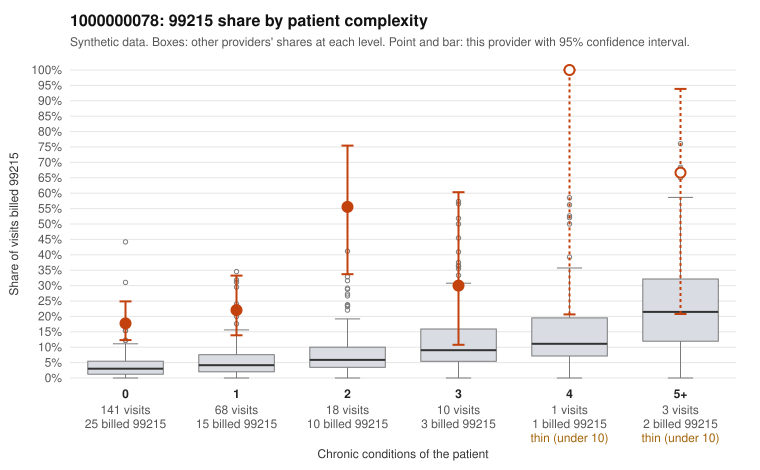

# 1000000078: 1000000078: too few returned records to judge

**Leaning (advisory):** Inconclusive

## Why

1000000078 billed 99215 on 23.2% of 241 claims against an expected 3.9% given patient complexity (risk-adjusted score 6.33; plain z-score vs peers 2.06). 71% of this provider's 99215 claims were on patients with 0 or 1 chronic conditions. Records came back for 21 claims. Of 18 documented 99215 claims, 0 (0%) were documented below the billed level, against 16% for the comparison providers. Note checks on 21 returned notes (share showing each sign): problems 33%, late 0%, unsigned 0%, data 5%. No audit trail was received. 1 of 20 notes claiming moderate-or-higher data reviewed had no lab or test line on the claim. The evidence does not support a call either way yet. Examples: C0036173: billed 99215, patient aged 44 with 0 chronic condition(s). C0036185: billed 99215, patient aged 36 with 1 chronic condition(s) (asthma).

## Evidence chart

## Cited claims

`C0036173`, `C0036185`

## Suggested next steps

- 21 charts came back but do not settle it: request a targeted sample of 99215 charts, starting with C0036173, C0036185.
- Re-check after the targeted charts arrive; do not call upcoding or a sicker panel on this evidence alone.

---
Citations checked: 2/2 valid. Synthetic data. The leaning is advisory; the flag comes from the statistical screen, and no clinical documentation is available beyond the sampled records-review facts shown in the packet.
