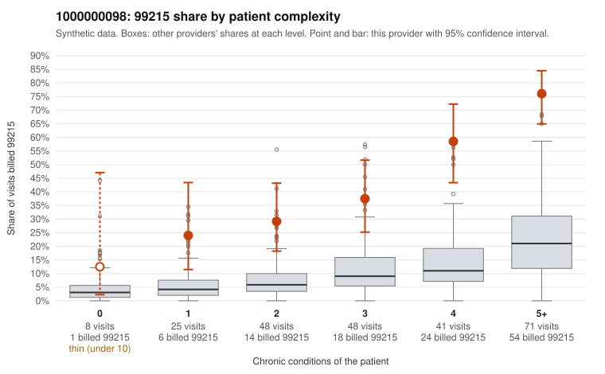

# 1000000098: 1000000098: too few returned records to judge

**Leaning (advisory):** Inconclusive

## Why

1000000098 billed 99215 on 48.5% of 241 claims against an expected 11.7% given patient complexity (risk-adjusted score 7.41; plain z-score vs peers 5.43). 6% of this provider's 99215 claims were on patients with 0 or 1 chronic conditions. Records came back for 30 claims. Of 18 documented 99215 claims, 2 (11%) were documented below the billed level, against 16% for the comparison providers. Note checks on 30 returned notes (share showing each sign): problems 3%, late 3%, unsigned 0%, data 3%. No audit trail was received. 3 of 21 notes claiming moderate-or-higher data reviewed had no lab or test line on the claim. The evidence does not support a call either way yet. Examples: C0045570: billed 99215; documented MDM level moderate, 36 minutes. C0045595: billed 99215, patient aged 54 with 1 chronic condition(s) (asthma); documented MDM level moderate, minutes not recorded. C0045464: billed 99215, patient aged 35 with 1 chronic condition(s) (osteoarthritis). C0045521: billed 99215, patient aged 47 with 1 chronic condition(s) (hypothyroidism).

## Evidence chart

## Cited claims

`C0045570`, `C0045595`, `C0045464`, `C0045521`

## Suggested next steps

- 30 charts came back but do not settle it: request a targeted sample of 99215 charts, starting with C0045570, C0045595, C0045464.
- Re-check after the targeted charts arrive; do not call upcoding or a sicker panel on this evidence alone.

---
Citations checked: 4/4 valid. Synthetic data. The leaning is advisory; the flag comes from the statistical screen, and no clinical documentation is available beyond the sampled records-review facts shown in the packet.
