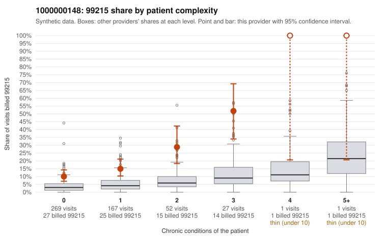

# 1000000148: 1000000148: too few returned records to judge

**Leaning (advisory):** Inconclusive

## Why

1000000148 billed 99215 on 16.1% of 517 claims against an expected 3.9% given patient complexity (risk-adjusted score 5.82; plain z-score vs peers 1.11). 63% of this provider's 99215 claims were on patients with 0 or 1 chronic conditions. Records came back for 45 claims. Of 19 documented 99215 claims, 2 (10%) were documented below the billed level, against 16% for the comparison providers. Note checks on 45 returned notes (share showing each sign): problems 58%, late 2%, unsigned 0%, data 4%. No audit trail was received. 4 of 40 notes claiming moderate-or-higher data reviewed had no lab or test line on the claim. The evidence does not support a call either way yet. Examples: C0067299: billed 99215; documented MDM level low, 21 minutes. C0067408: billed 99215; documented MDM level moderate, minutes not recorded. C0067253: billed 99215, patient aged 69 with 1 chronic condition(s) (COPD). C0067259: billed 99215, patient aged 41 with 0 chronic condition(s).

## Evidence chart

## Cited claims

`C0067299`, `C0067408`, `C0067253`, `C0067259`

## Suggested next steps

- 45 charts came back but do not settle it: request a targeted sample of 99215 charts, starting with C0067299, C0067408, C0067253.
- Re-check after the targeted charts arrive; do not call upcoding or a sicker panel on this evidence alone.

---
Citations checked: 4/4 valid. Synthetic data. The leaning is advisory; the flag comes from the statistical screen, and no clinical documentation is available beyond the sampled records-review facts shown in the packet.
