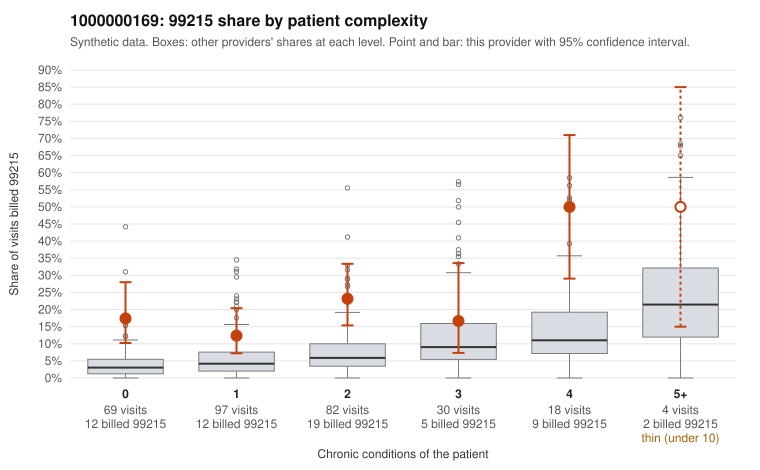

# 1000000169: 1000000169: too few returned records to judge

**Leaning (advisory):** Inconclusive

## Why

1000000169 billed 99215 on 19.7% of 300 claims against an expected 5.5% given patient complexity (risk-adjusted score 4.41; plain z-score vs peers 1.59). 41% of this provider's 99215 claims were on patients with 0 or 1 chronic conditions. Records came back for 45 claims. Of 18 documented 99215 claims, 2 (11%) were documented below the billed level, against 16% for the comparison providers. Note checks on 45 returned notes (share showing each sign): problems 38%, late 7%, unsigned 0%, data 11%, bulk created 0%, paste heavy 0%. 5 of 33 notes claiming moderate-or-higher data reviewed had no lab or test line on the claim. The evidence does not support a call either way yet. Examples: C0077174: billed 99215, patient aged 36 with 1 chronic condition(s) (hyperlipidemia); documented MDM level moderate, minutes not recorded. C0077310: billed 99215, patient aged 76 with 1 chronic condition(s) (asthma); documented MDM level moderate, 37 minutes. C0077144: billed 99215, patient aged 68 with 0 chronic condition(s). C0077160: billed 99215, patient aged 48 with 1 chronic condition(s) (hypertension).

## Evidence chart

## Cited claims

`C0077174`, `C0077310`, `C0077144`, `C0077160`

## Suggested next steps

- 45 charts came back but do not settle it: request a targeted sample of 99215 charts, starting with C0077174, C0077310, C0077144.
- Re-check after the targeted charts arrive; do not call upcoding or a sicker panel on this evidence alone.

---
Citations checked: 4/4 valid. Synthetic data. The leaning is advisory; the flag comes from the statistical screen, and no clinical documentation is available beyond the sampled records-review facts shown in the packet.
