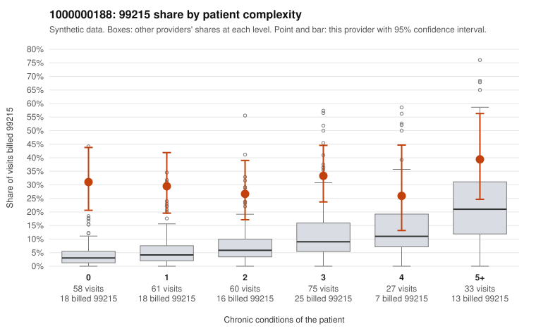

# 1000000188: 1000000188: too few returned records to judge

**Leaning (advisory):** Inconclusive

## Why

1000000188 billed 99215 on 30.9% of 314 claims against an expected 7.8% given patient complexity (risk-adjusted score 6.33; plain z-score vs peers 3.08). 37% of this provider's 99215 claims were on patients with 0 or 1 chronic conditions. Records came back for 29 claims. Of 11 documented 99215 claims, 0 (0%) were documented below the billed level, against 16% for the comparison providers. Note checks on 29 returned notes (share showing each sign): problems 21%, late 17%, unsigned 0%, data 3%. No audit trail was received. 2 of 26 notes claiming moderate-or-higher data reviewed had no lab or test line on the claim. The evidence does not support a call either way yet. Examples: C0088852: billed 99215, patient aged 58 with 1 chronic condition(s) (depression). C0088858: billed 99215, patient aged 59 with 1 chronic condition(s) (hypertension).

## Evidence chart

## Cited claims

`C0088852`, `C0088858`

## Suggested next steps

- 29 charts came back but do not settle it: request a targeted sample of 99215 charts, starting with C0088852, C0088858.
- Re-check after the targeted charts arrive; do not call upcoding or a sicker panel on this evidence alone.

---
Citations checked: 2/2 valid. Synthetic data. The leaning is advisory; the flag comes from the statistical screen, and no clinical documentation is available beyond the sampled records-review facts shown in the packet.
