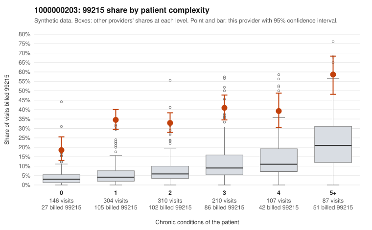

# 1000000203: 1000000203: too few returned records to judge

**Leaning (advisory):** Inconclusive

## Why

1000000203 billed 99215 on 35.5% of 1,164 claims against an expected 7.3% given patient complexity (risk-adjusted score 15.49; plain z-score vs peers 3.69). 32% of this provider's 99215 claims were on patients with 0 or 1 chronic conditions. Records came back for 30 claims. Of 11 documented 99215 claims, 2 (18%) were documented below the billed level, against 16% for the comparison providers. Note checks on 30 returned notes (share showing each sign): problems 20%, late 27%, unsigned 0%, data 23%. No audit trail was received. 9 of 25 notes claiming moderate-or-higher data reviewed had no lab or test line on the claim. The evidence does not support a call either way yet. Examples: C0097319: billed 99215; documented MDM level moderate, minutes not recorded. C0097932: billed 99215; documented MDM level moderate, minutes not recorded. C0097073: billed 99215, patient aged 59 with 0 chronic condition(s). C0097107: billed 99215, patient aged 52 with 1 chronic condition(s) (COPD).

## Evidence chart

## Cited claims

`C0097319`, `C0097932`, `C0097073`, `C0097107`

## Suggested next steps

- 30 charts came back but do not settle it: request a targeted sample of 99215 charts, starting with C0097319, C0097932, C0097073.
- Re-check after the targeted charts arrive; do not call upcoding or a sicker panel on this evidence alone.

---
Citations checked: 4/4 valid. Synthetic data. The leaning is advisory; the flag comes from the statistical screen, and no clinical documentation is available beyond the sampled records-review facts shown in the packet.
