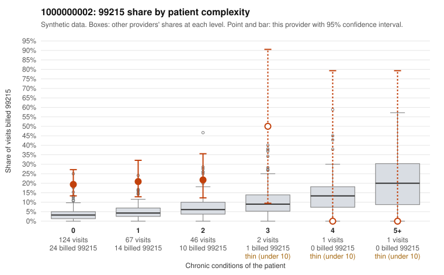

# 1000000002: 1000000002: 15 of 20 documented 99215 claims (75%) are documented below the billed level

**Leaning (advisory):** Pattern consistent with upcoding

## Why

1000000002 billed 99215 on 20.3% of 241 claims against an expected 4.0% given patient complexity (risk-adjusted score 5.68; plain z-score vs peers 2.94). 78% of this provider's 99215 claims were on patients with 0 or 1 chronic conditions. Records came back for 44 claims. Of 20 documented 99215 claims, 15 (75%) were documented below the billed level, against 32% for the comparison providers. Note checks on 44 returned notes (share showing each sign): problems 32%, late 0%, unsigned 0%, data 2%. No audit trail was received. 2 of 28 notes claiming moderate-or-higher data reviewed had no lab or test line on the claim. This pattern is consistent with upcoding. It is a reason to review the records, not a finding. Examples: C0000362: billed 99215, patient aged 65 with 0 chronic condition(s); documented MDM level moderate, minutes not recorded. C0000402: billed 99215, patient aged 67 with 0 chronic condition(s); documented MDM level moderate, 25 minutes. C0000472: billed 99215; documented MDM level moderate, 33 minutes. C0000342: billed 99215, patient aged 43 with 1 chronic condition(s) (hypothyroidism). C0000345: billed 99215, patient aged 32 with 1 chronic condition(s) (depression). C0000351: billed 99215, patient aged 83 with 1 chronic condition(s) (type 2 diabetes).

## Evidence chart

## Cited claims

`C0000362`, `C0000402`, `C0000472`, `C0000342`, `C0000345`, `C0000351`

## Suggested next steps

- Request the full charts for C0000362, C0000402, C0000472 and have a certified coder re-score each against the current E/M rules (medical decision making or total time).
- If the re-scoring confirms the pattern, review the random sample in the recovery packet's sampling plan before any overpayment estimate; do not extrapolate from a targeted sample.
- Look at the notes themselves: 32% address fewer problems than their level implies and 0% were signed late; request the audit trail for C0000362, C0000402, C0000472.

---
Citations checked: 6/6 valid. Synthetic data. The leaning is advisory; the flag comes from the statistical screen, and no clinical documentation is available beyond the sampled records-review facts shown in the packet.
