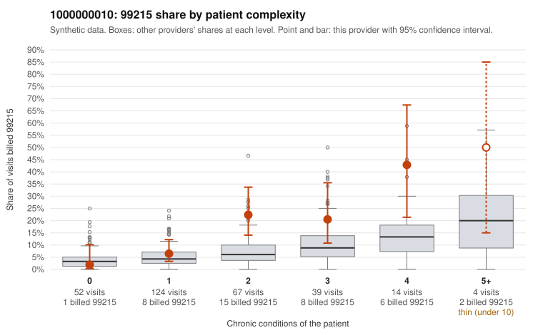

# 1000000010: 1000000010: too few returned records to judge

**Leaning (advisory):** Inconclusive

## Why

1000000010 billed 99215 on 13.3% of 300 claims against an expected 5.3% given patient complexity (risk-adjusted score 2.71; plain z-score vs peers 1.45). 22% of this provider's 99215 claims were on patients with 0 or 1 chronic conditions. Records came back for 30 claims. Of 5 documented 99215 claims, 3 (60%) were documented below the billed level, against 32% for the comparison providers. Note checks on 30 returned notes (share showing each sign): problems 27%, late 0%, unsigned 0%, data 13%. No audit trail was received. 4 of 20 notes claiming moderate-or-higher data reviewed had no lab or test line on the claim. The evidence does not support a call either way yet. Examples: C0004181: billed 99215, patient aged 67 with 4 chronic condition(s) (hypothyroidism;type 2 diabetes;depression;hypertension); documented MDM level moderate, 38 minutes. C0004270: billed 99215, patient aged 60 with 1 chronic condition(s) (osteoarthritis); documented MDM level moderate, 23 minutes. C0004184: billed 99215, patient aged 18 with 0 chronic condition(s). C0004189: billed 99215, patient aged 57 with 1 chronic condition(s) (type 2 diabetes).

## Evidence chart

## Cited claims

`C0004181`, `C0004270`, `C0004184`, `C0004189`

## Suggested next steps

- 30 charts came back but do not settle it: request a targeted sample of 99215 charts, starting with C0004181, C0004270, C0004184.
- Re-check after the targeted charts arrive; do not call upcoding or a sicker panel on this evidence alone.

---
Citations checked: 4/4 valid. Synthetic data. The leaning is advisory; the flag comes from the statistical screen, and no clinical documentation is available beyond the sampled records-review facts shown in the packet.
