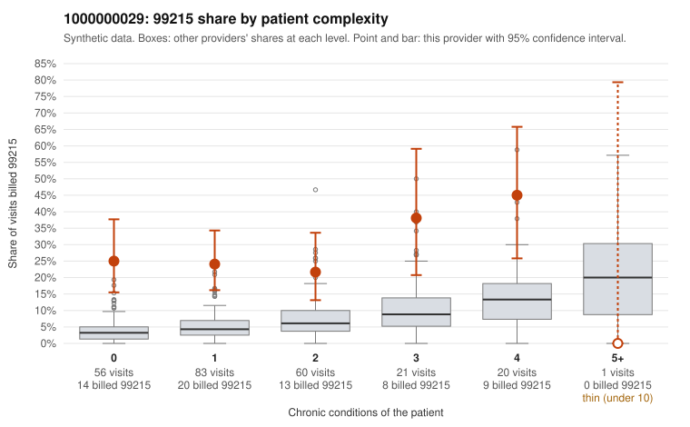

# 1000000029: 1000000029: 9 of 10 documented 99215 claims (90%) are documented below the billed level

**Leaning (advisory):** Pattern consistent with upcoding

## Why

1000000029 billed 99215 on 26.6% of 241 claims against an expected 5.3% given patient complexity (risk-adjusted score 6.54; plain z-score vs peers 4.26). 53% of this provider's 99215 claims were on patients with 0 or 1 chronic conditions. Records came back for 29 claims. Of 10 documented 99215 claims, 9 (90%) were documented below the billed level, against 32% for the comparison providers. Note checks on 29 returned notes (share showing each sign): problems 17%, late 3%, unsigned 0%, data 7%. No audit trail was received. 3 of 19 notes claiming moderate-or-higher data reviewed had no lab or test line on the claim. This pattern is consistent with upcoding. It is a reason to review the records, not a finding. Examples: C0012118: billed 99215; documented MDM level moderate, 30 minutes. C0012123: billed 99215, patient aged 41 with 4 chronic condition(s) (hyperlipidemia;depression;asthma;osteoarthritis); documented MDM level moderate, 34 minutes. C0012151: billed 99215; documented MDM level moderate, minutes not recorded. C0012130: billed 99215, patient aged 61 with 1 chronic condition(s) (hypertension). C0012136: billed 99215, patient aged 59 with 0 chronic condition(s). C0012147: billed 99215, patient aged 25 with 0 chronic condition(s).

## Evidence chart

## Cited claims

`C0012118`, `C0012123`, `C0012151`, `C0012130`, `C0012136`, `C0012147`

## Suggested next steps

- Request the full charts for C0012118, C0012123, C0012151 and have a certified coder re-score each against the current E/M rules (medical decision making or total time).
- If the re-scoring confirms the pattern, review the random sample in the recovery packet's sampling plan before any overpayment estimate; do not extrapolate from a targeted sample.
- Look at the notes themselves: 17% address fewer problems than their level implies and 3% were signed late; request the audit trail for C0012118, C0012123, C0012151.

---
Citations checked: 6/6 valid. Synthetic data. The leaning is advisory; the flag comes from the statistical screen, and no clinical documentation is available beyond the sampled records-review facts shown in the packet.
