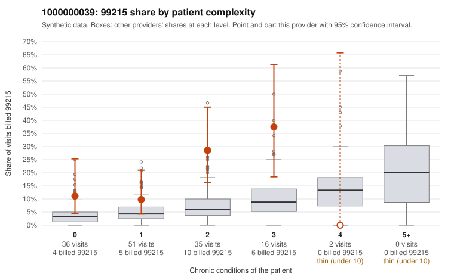

# 1000000039: 1000000039: too few returned records to judge

**Leaning (advisory):** Inconclusive

## Why

1000000039 billed 99215 on 17.9% of 140 claims against an expected 4.8% given patient complexity (risk-adjusted score 3.15; plain z-score vs peers 2.41). 36% of this provider's 99215 claims were on patients with 0 or 1 chronic conditions. Records came back for 45 claims. Of 20 documented 99215 claims, 2 (10%) were documented below the billed level, against 32% for the comparison providers. Note checks on 45 returned notes (share showing each sign): problems 22%, late 13%, unsigned 0%, data 2%. No audit trail was received. 3 of 34 notes claiming moderate-or-higher data reviewed had no lab or test line on the claim. The evidence does not support a call either way yet. Examples: C0017885: billed 99215; documented MDM level moderate, 38 minutes. C0017941: billed 99215; documented MDM level moderate, 39 minutes. C0017873: billed 99215, patient aged 48 with 0 chronic condition(s). C0017891: billed 99215, patient aged 55 with 0 chronic condition(s).

## Evidence chart

## Cited claims

`C0017885`, `C0017941`, `C0017873`, `C0017891`

## Suggested next steps

- 45 charts came back but do not settle it: request a targeted sample of 99215 charts, starting with C0017885, C0017941, C0017873.
- Re-check after the targeted charts arrive; do not call upcoding or a sicker panel on this evidence alone.

---
Citations checked: 4/4 valid. Synthetic data. The leaning is advisory; the flag comes from the statistical screen, and no clinical documentation is available beyond the sampled records-review facts shown in the packet.
